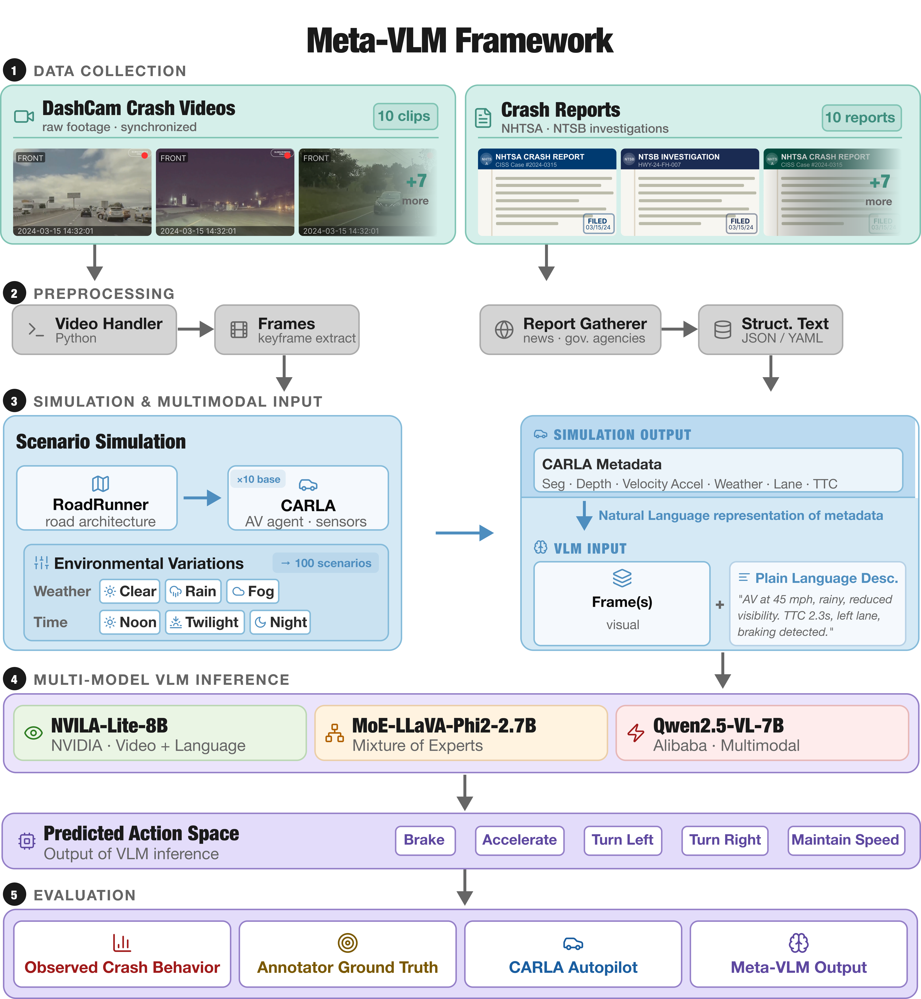

# MetaVLM Dataset

## Overview

**Meta-VLM** is a systematic framework for evaluating the role of metadata in Vision-Language Model (VLM)-based autonomous driving decisions. VLMs offer promising advances for AV decision-making through enhanced semantic reasoning, yet their deployment in safety-critical scenarios remains unexplored due to the absence of datasets combining real crash scenarios with comprehensive metadata. Meta-VLM addresses this gap by reconstructing 20 real-world crash scenarios from two complementary sources — dashcam footage and documented crash reports — within the CARLA simulator, generating synchronized multimodal metadata including semantic segmentation, depth maps, vehicle kinematics, and environmental conditions.

### Pipeline

The figure below illustrates the Meta-VLM pipeline, which transforms real dashcam videos and crash reports into high-fidelity CARLA simulations, extracts synchronized multimodal metadata, and evaluates three architecturally diverse VLMs (NVILA-Lite-8B, MoE-LLaVA, and Qwen2.5-VL) across ~12,000 decision instances using hierarchical metadata ablation. VLM outputs are compared against expert ground truth, CARLA autopilot responses, and observed crash behaviors.



Our results reveal that VLMs achieve **72.8% mean agreement** with expert decisions, surpassing traditional autopilot systems (59.8%) by 13.0 percentage points. Weather metadata emerges as the dominant factor across all three architectures, providing a **9.7% relative improvement** over vision-only baselines, while an optimal minimal subset combining ego-vehicle state and weather information captures **92.9% of full metadata performance** with 43% reduced computational overhead.

### Dataset

The dataset comprises 20 base scenarios reconstructed from documented AV failures, expanded to ~100 total instances through systematic environmental variations (weather and time of day). Each scenario includes synchronized RGB imagery, semantic segmentation, depth maps, ego-vehicle kinematics, and environmental metadata.

**Key Statistics:**
- **20 Base Scenarios**: 10 from dashcam videos + 10 from crash reports
- **~100 Total Instances**: Expanded through weather and lighting variations
- **~12,000 Evaluations**: Across 5 metadata configurations and 3 VLM architectures
- **High-Fidelity Reconstruction**: CARLA simulator with precise speed, trajectory, and geometry matching

## Table of Contents

- [Dataset Structure](#dataset-structure)
- [Base Scenarios](#base-scenarios)
- [Environmental Variations](#environmental-variations)
- [Simulation Scripts](#simulation-scripts)
- [Metadata Schema](#metadata-schema)
- [Getting Started](#getting-started)


## Base Scenarios

The dataset comprises 20 base scenarios representing documented AV failures:

### Video-Sourced Scenarios (10 scenarios)

| ID | Name | Speed | Date | Location | Notes |
|----|------|-------|------|----------|-------|
| [01\_VID\_FTSA](scenarios/01_VID_FTSA.md) | Secondary Collision | ~92 km/h | Aug 15, 2023 | CA-101 | Tesla FSD failure |
| [02\_VID\_FTSB](scenarios/02_VID_FTSB.md) | Rear-End Collision | ~73 km/h | Jun 22, 2023 | I-5 | High-speed impact |
| [03\_VID\_FTSI](scenarios/03_VID_FTSI.md) | Intersection Failure | ~6 km/h | Sep 10, 2023 | Urban intersection | Red light scenario |
| [04\_VID\_LV](scenarios/04_VID_LV.md) | Lane Departure | ~88 km/h | Jul 28, 2023 | US-101 | Highway scenario |
| [05\_VID\_ORS](scenarios/05_VID_ORS.md) | Off-Road Hazard | ~82 km/h | May 14, 2023 | Unknown | Road edge departure |
| [06\_VID\_FSD](scenarios/06_VID_FSD.md) | FSD Exit Attempt | ~58 km/h | Unknown | Highway | FSD v13.2.8 failure |
| [07\_VID\_ROBO](scenarios/07_VID_ROBO.md) | Robotaxi Incident | ~34 km/h | Jun 22, 2025 | Urban | FSD V14.3 autonomous mode |
| [08\_VID\_M3](scenarios/08_VID_M3.md) | Model 3 FSD Crash | ~72 km/h | Feb 27, 2025 | Rural highway | FSD v13.2.8 failure |
| [09\_VID\_CRASH](scenarios/09_VID_CRASH.md) | High-Speed Highway Collision | ~87 km/h | Feb 27, 2021 | Highway | Nighttime scenario |
| [10\_VID\_BIKE](scenarios/10_VID_BIKE.md) | Pedestrian Fatality | ~61 km/h | Mar 18, 2018 | Highway | Nighttime fatality |

*Note: Full details including exact source URLs and reconstruction parameters available in `/scenarios/base_scenarios/`*

### Report-Sourced Scenarios (10 scenarios)

| ID | Name | Speed | Date | Location | Notes |
|----|------|-------|------|----------|-------|
| [11\_REP\_HAND](scenarios/11_REP_HAND.md) | Handan Stationary Truck | ~100 km/h | Jan 20, 2016 | Handan, China | First China Autopilot fatality |
| [12\_REP\_WILL](scenarios/12_REP_WILL.md) | Williston Semi-Trailer | ~105 km/h | May 7, 2016 | Williston, FL | First US Autopilot fatality |
| [13\_REP\_MTV](scenarios/13_REP_MTV.md) | Mountain View Barrier | ~105 km/h | Mar 23, 2018 | Mountain View, CA | Highway barrier collision |
| [14\_REP\_KAN](scenarios/14_REP_KAN.md) | Kanagawa Pedestrian | ~39 km/h | Apr 29, 2018 | Kanagawa, Japan | First Autopilot pedestrian fatality |
| [15\_REP\_DELR](scenarios/15_REP_DELR.md) | Delray Beach Semi-Trailer | ~89 km/h | Mar 1, 2019 | Delray Beach, FL | Underride collision scenario |
| [16\_REP\_KEYL](scenarios/16_REP_KEYL.md) | Key Largo Stop Sign | ~56 km/h | Apr 25, 2019 | Key Largo, FL | Intersection stop sign failure |
| [17\_REP\_CLVD](scenarios/17_REP_CLVD.md) | Cloverdale Fire Truck | ~113 km/h | Dec 29, 2019 | Cloverdale, IN | Stationary emergency vehicle |
| [18\_REP\_GARD](scenarios/18_REP_GARD.md) | Gardena Red Light | ~72 km/h | Dec 29, 2019 | Gardena, CA | Nighttime red light failure |
| [19\_REP\_AREN](scenarios/19_REP_AREN.md) | Arendal Parked Truck | ~109 km/h | May 29, 2020 | Arendal, Norway | Tunnel exit obstruction |
| [20\_REP\_FONT](scenarios/20_REP_FONT.md) | Fontana Overturned Trailer | ~105 km/h | May 5, 2021 | Fontana, CA | Nighttime freeway obstruction |


## Reconstruction Fidelity

We characterize how faithfully each scenario matches its real-world source at three levels: how the scene looks (appearance), how the vehicles move (kinematic), and how the conflict unfolds (behavioral). Appearance fidelity is measured for video-sourced scenarios by comparing reconstructed viewpoints against source frames (SSIM > 0.85). Kinematic fidelity is summarized below: for video-sourced scenarios the documented speed is recovered from footage using FHWA lane-marking spacing and verified against the in-cabin speedometer where visible; for report-sourced scenarios it is taken from official NHTSA/NTSB documentation. In both cases the simulated impact speed is produced by CARLA's vehicle physics rather than fixed by hand, so it varies from the documented value. Behavioral fidelity (relative placement, approach, and event ordering of the ego vehicle and hazard) follows the documented incident. Per-incident source URLs are in each linked scenario document above.

| ID | Documented (km/h) | Simulated (km/h) | Abs. dev (km/h) | Dev (%) | Reference |
|----|------:|------:|------:|------:|-----------|
| 01_VID_FTSA  | 92  | 90.3  | 1.7 | 1.8 | Footage (FHWA + speedometer) |
| 02_VID_FTSB  | 73  | 71.6  | 1.4 | 1.9 | Footage (FHWA + speedometer) |
| 03_VID_FTSI  | 6   | 5.7   | 0.3 | 5.0 | Footage (FHWA + speedometer) |
| 04_VID_LV    | 88  | 89.7  | 1.7 | 1.9 | Footage (FHWA + speedometer) |
| 05_VID_ORS   | 82  | 80.1  | 1.9 | 2.3 | Footage (FHWA + speedometer) |
| 06_VID_FSD   | 58  | 56.8  | 1.2 | 2.1 | Footage (FHWA + speedometer) |
| 07_VID_ROBO  | 34  | 33.1  | 0.9 | 2.6 | Footage (FHWA + speedometer) |
| 08_VID_M3    | 72  | 70.4  | 1.6 | 2.2 | Footage (FHWA + speedometer) |
| 09_VID_CRASH | 87  | 85.2  | 1.8 | 2.1 | Footage (FHWA + speedometer) |
| 10_VID_BIKE  | 61  | 62.3  | 1.3 | 2.1 | Footage (FHWA + speedometer) |
| 11_REP_HAND  | 100 | 99.2  | 0.8 | 0.8 | NHTSA/NTSB report |
| 12_REP_WILL  | 105 | 104.3 | 0.7 | 0.7 | NHTSA/NTSB report |
| 13_REP_MTV   | 105 | 105.8 | 0.8 | 0.8 | NHTSA/NTSB report |
| 14_REP_KAN   | 39  | 38.5  | 0.5 | 1.3 | NHTSA/NTSB report |
| 15_REP_DELR  | 89  | 88.4  | 0.6 | 0.7 | NHTSA/NTSB report |
| 16_REP_KEYL  | 56  | 55.6  | 0.4 | 0.7 | NHTSA/NTSB report |
| 17_REP_CLVD  | 113 | 112.1 | 0.9 | 0.8 | NHTSA/NTSB report |
| 18_REP_GARD  | 72  | 72.5  | 0.5 | 0.7 | NHTSA/NTSB report |
| 19_REP_AREN  | 109 | 108.4 | 0.6 | 0.6 | NHTSA/NTSB report |
| 20_REP_FONT  | 105 | 104.6 | 0.4 | 0.4 | NHTSA/NTSB report |

**Mean absolute deviation:** 1.0 km/h overall (1.4 km/h video-sourced, 0.6 km/h report-sourced).


## Environmental Variations

Each base scenario can be augmented with environmental variations. CARLA screenshots are available for all video-sourced scenarios (01–10) and all report-sourced scenarios (11–20).

### Variation Dimensions

**Weather Conditions:**
- `CLEAR`: No precipitation, good visibility (>10km)
- `RAIN`: Light to moderate rainfall, wet roads
- `FOG`: Reduced visibility (1-5km)

**Time of Day:**
- `NOON`: Full daylight
- `TWILIGHT`: Dawn/dusk conditions
- `NIGHT`: Low light conditions


## Simulation Scripts

CARLA reconstruction scripts provided in the [`scripts/`](scripts/) directory. Each script spawns the ego vehicle, configures sensors (RGB, semantic segmentation, depth), runs the scenario to completion, and writes per-frame metadata to a `metadata.jsonl` file.

**Prerequisites:** CARLA 0.9.x running locally with PythonAPI configured.

**Run any scenario:**
```bash
# Place the script inside your CARLA PythonAPI directory tree, then:
python <scenario_id>_scenario.py
```

Output frames and `metadata.jsonl` are saved to `./sessions/<timestamp>/`.

| Script | Scenario |
|--------|---------|
| [`01_VID_FTSA_scenario.py`](scripts/01_VID_FTSA_scenario.py) | CA-101 — FSD Secondary Collision |
| [`02_VID_FTSB_scenario.py`](scripts/02_VID_FTSB_scenario.py) | I-5 — High-Speed Rear-End Collision |
| [`03_VID_FTSI_scenario.py`](scripts/03_VID_FTSI_scenario.py) | Urban Intersection — Red Light Failure |
| [`04_VID_LV_scenario.py`](scripts/04_VID_LV_scenario.py) | US-101 — Highway Lane Departure |
| [`05_VID_ORS_scenario.py`](scripts/05_VID_ORS_scenario.py) | Off-Road Hazard Departure |
| [`06_VID_FSD_scenario.py`](scripts/06_VID_FSD_scenario.py) | Highway — FSD v13.2.8 Exit Attempt Failure |
| [`07_VID_ROBO_scenario.py`](scripts/07_VID_ROBO_scenario.py) | Urban — Tesla Robotaxi Failed Left Turn |
| [`08_VID_M3_scenario.py`](scripts/08_VID_M3_scenario.py) | Rural Highway — Model 3 FSD Tree Crash |
| [`09_VID_CRASH_scenario.py`](scripts/09_VID_CRASH_scenario.py) | Highway — High-Speed Nighttime Collision |
| [`10_VID_BIKE_scenario.py`](scripts/10_VID_BIKE_scenario.py) | Highway — Nighttime Pedestrian Fatality |
| [`11_REP_HAND_scenario.py`](scripts/11_REP_HAND_scenario.py) | Handan, China — Stationary Street Sweeper |
| [`12_REP_WILL_scenario.py`](scripts/12_REP_WILL_scenario.py) | Williston, Florida — Left-Turning Semi-Trailer |
| [`13_REP_MTV_scenario.py`](scripts/13_REP_MTV_scenario.py) | Mountain View, California — Highway Barrier |
| [`14_REP_KAN_scenario.py`](scripts/14_REP_KAN_scenario.py) | Kanagawa, Japan — Expressway Pedestrian Strike |
| [`15_REP_DELR_scenario.py`](scripts/15_REP_DELR_scenario.py) | Delray Beach, Florida — Semi-Trailer Underride |
| [`16_REP_KEYL_scenario.py`](scripts/16_REP_KEYL_scenario.py) | Key Largo, Florida — T-Intersection Stop Sign Failure |
| [`17_REP_CLVD_scenario.py`](scripts/17_REP_CLVD_scenario.py) | Cloverdale, Indiana — Stationary Fire Truck on Highway |
| [`18_REP_GARD_scenario.py`](scripts/18_REP_GARD_scenario.py) | Gardena, California — Nighttime Red Light Failure |
| [`19_REP_AREN_scenario.py`](scripts/19_REP_AREN_scenario.py) | Arendal, Norway — Parked Truck After Tunnel Exit |
| [`20_REP_FONT_scenario.py`](scripts/20_REP_FONT_scenario.py) | Fontana, California — Nighttime Overturned Trailer on Freeway |
