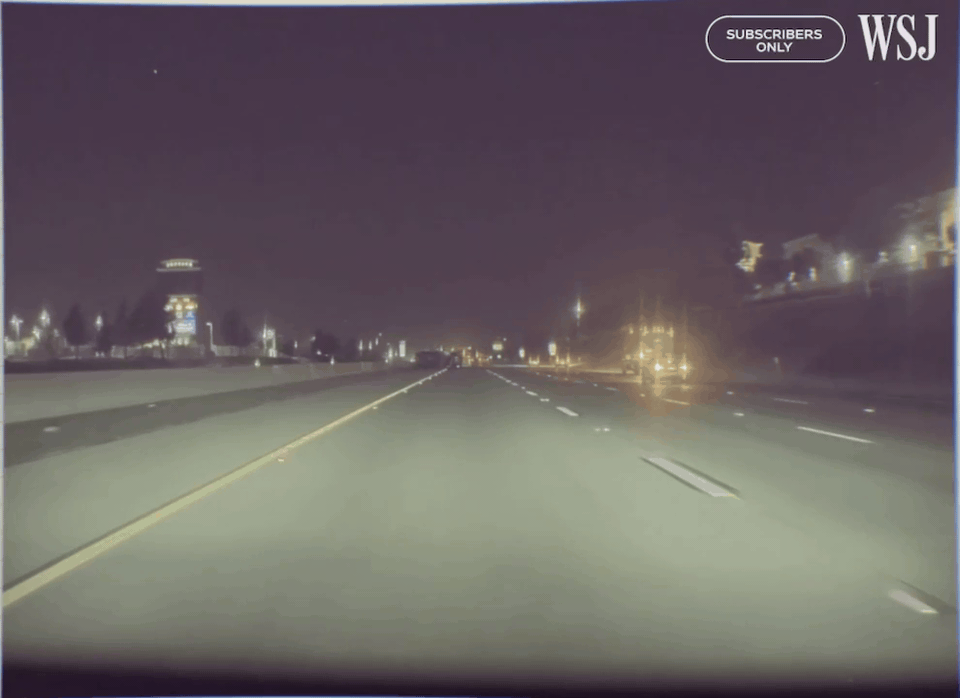
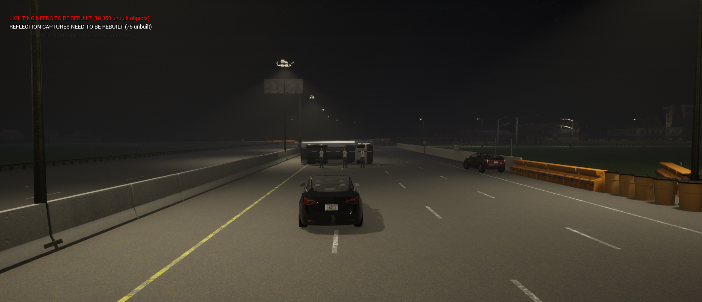

# 01. CA-101 — FSD Secondary Collision

**ID:** `01_VID_FTSA` | **Date:** August 15, 2023 | **Location:** Highway CA-101

## Incident Summary

| Field | Detail |
|-------|--------|
| Vehicle | Tesla Model 3 |
| AV System | FSD |
| Speed at Impact | ~56.88 mph (~92 km/h) |
| Original Weather | Clear |
| Original Lighting | Daylight |
| Video Duration | 6 sec @ 30 fps (992×720) |
| CARLA Map | TBD |

A Tesla Model 3 operating under FSD was involved in a secondary collision on Highway CA-101. The vehicle failed to respond to a stopped or slowing vehicle ahead, resulting in an impact. This incident was documented as part of the WSJ investigation into Tesla Autopilot and FSD crash patterns.

**Notes:** WSJ Investigation — Original video 1.

**Source:** [WSJ — Tesla Autopilot Crash Investigation](https://www.wsj.com/business/autos/tesla-autopilot-crash-investigation-997b0129)

---

## CARLA Simulation

| Parameter | Value |
|-----------|-------|
| Map | TBD |
| Origin | TBD |
| Destination | TBD |

> *CARLA simulation coordinates to be added.*

### Environmental Variations

---

[Back to Dataset Overview](../README.md)
