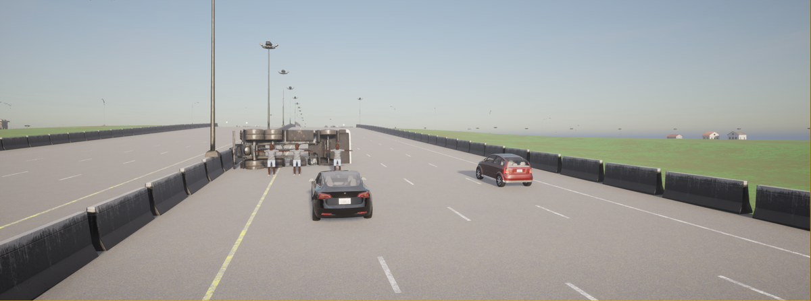
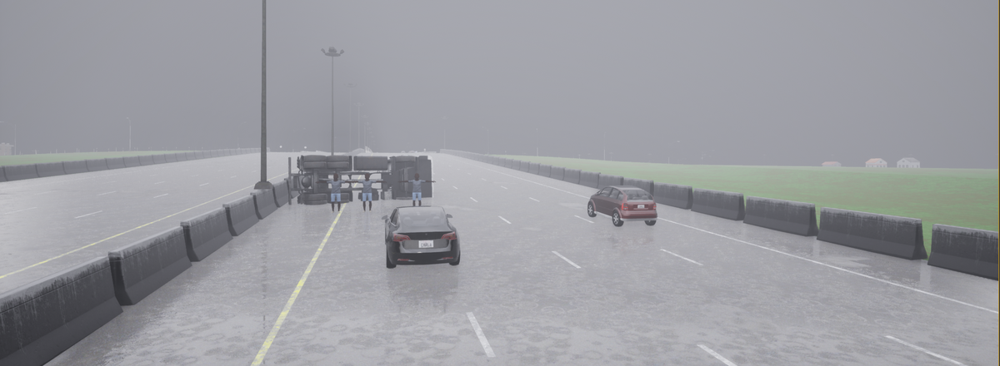
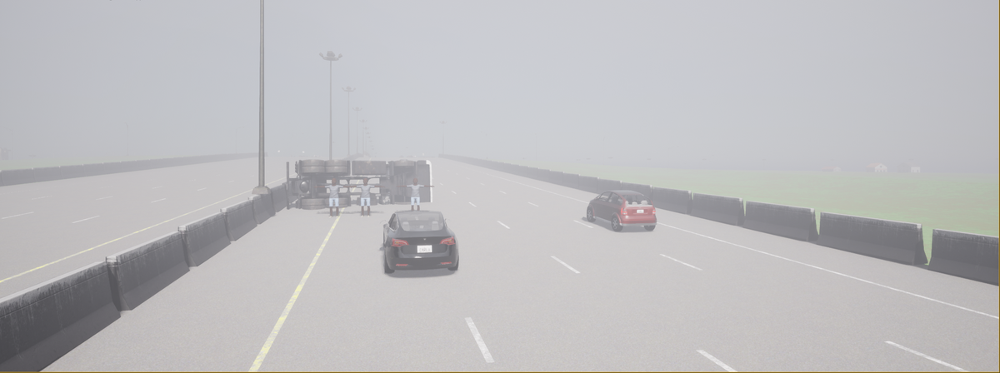
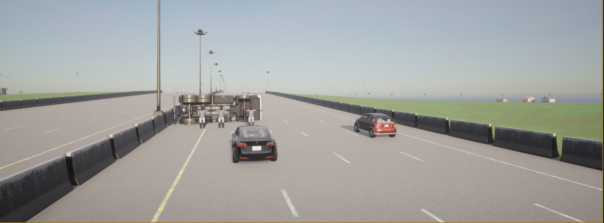
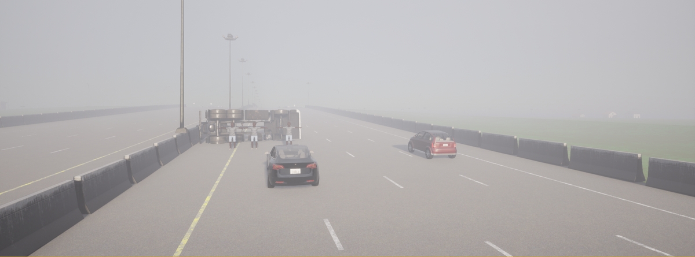
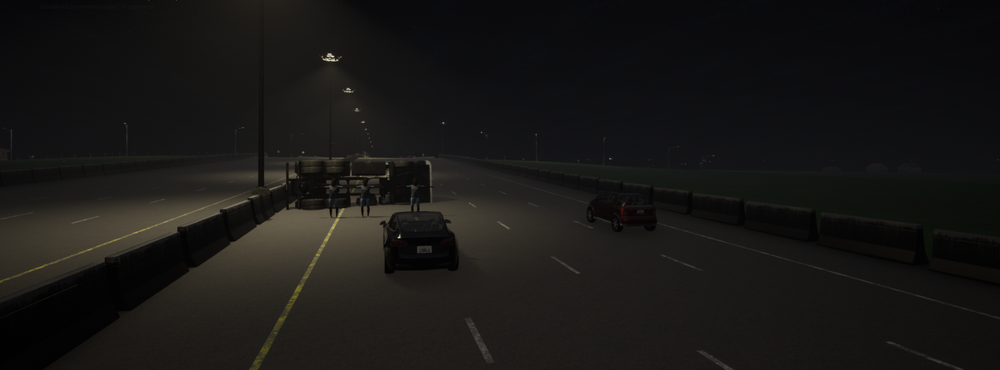
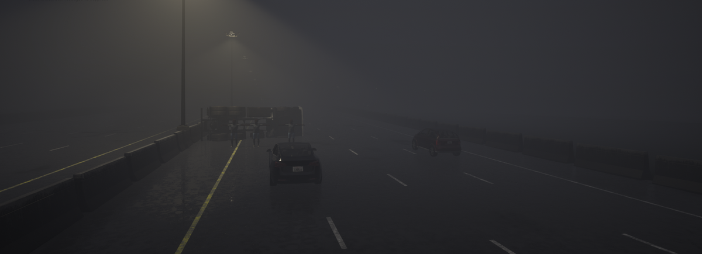
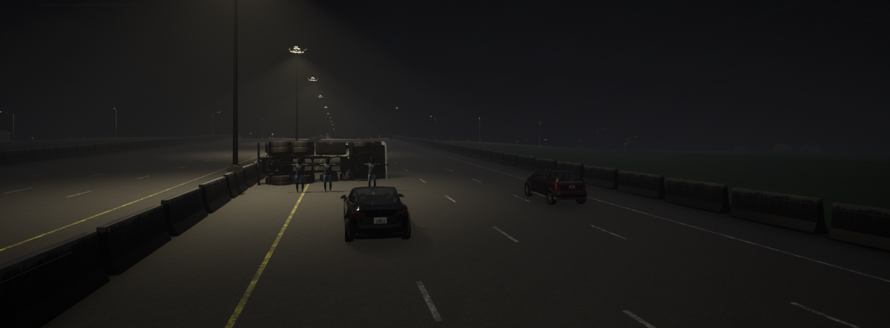

# 01. CA-101 — FSD Secondary Collision

**ID:** `01_VID_FTSA` | **Date:** August 15, 2023 | **Location:** Highway CA-101

## Incident Summary

| Field | Detail |
|-------|--------|
| Vehicle | Tesla Model 3 |
| AV System | FSD |
| Speed at Impact | ~56.88 mph (~92 km/h) |
| Original Weather | Clear |
| Original Lighting | Daylight |
| Video Duration | 6 sec @ 30 fps (992×720) |
| CARLA Map | Town04 |


A Tesla Model 3 operating under FSD was involved in a secondary collision on Highway CA-101. The vehicle failed to respond to a stopped or slowing vehicle ahead, resulting in an impact. This incident was documented as part of the WSJ investigation into Tesla Autopilot and FSD crash patterns.

**Notes:** WSJ Investigation — Original video 1.

**Source:** [WSJ — Tesla Autopilot Crash Investigation](https://www.wsj.com/business/autos/tesla-autopilot-crash-investigation-997b0129)

---

## CARLA Simulation

| Parameter | Value |
|-----------|-------|
| Map | Town04 |
| Origin | x=4.48, y=184, z=1.9 |
| Destination | x=5, y=-143, z=2 |

### Environmental Variations

| Noon — Clear | Noon — Rain | Noon — Fog |
|:---:|:---:|:---:|
|  |  |  |

| Twilight — Clear | Twilight — Rain | Twilight — Fog |
|:---:|:---:|:---:|
|  |  |  |

| Night — Clear | Night — Rain | Night — Fog |
|:---:|:---:|:---:|
|  |  |  |

### Simulation Script

The CARLA reconstruction script for this scenario is [`scripts/01_VID_FTSA_scenario.py`](../scripts/01_VID_FTSA_scenario.py).

**Prerequisites:** CARLA 0.9.x running locally with PythonAPI configured.

**Run:**
```bash
# Place inside your CARLA PythonAPI directory tree, then:
python 01_VID_FTSA_scenario.py
```

Output frames and `metadata.jsonl` are saved to `./sessions/<timestamp>/`.

---

[Back to Dataset Overview](../README.md)
