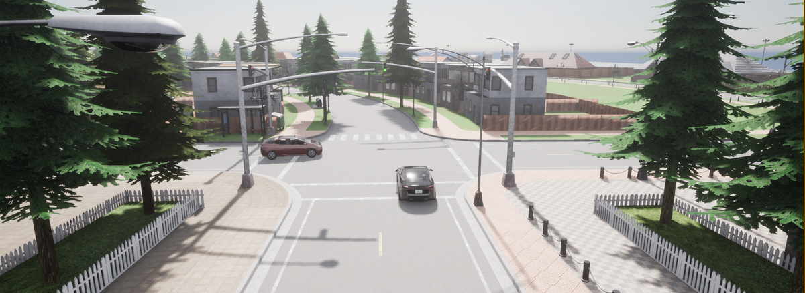
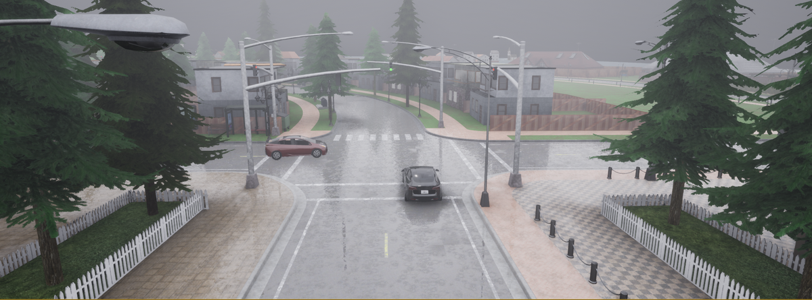
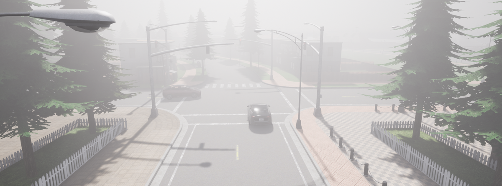
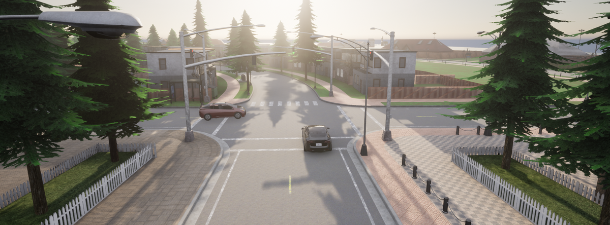
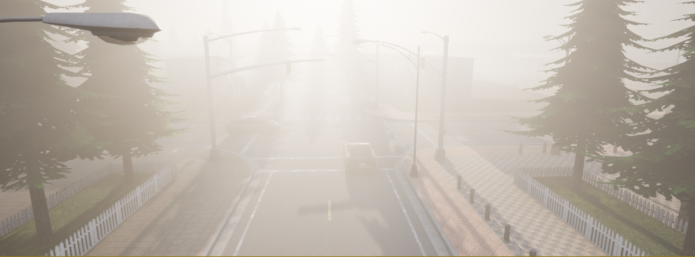
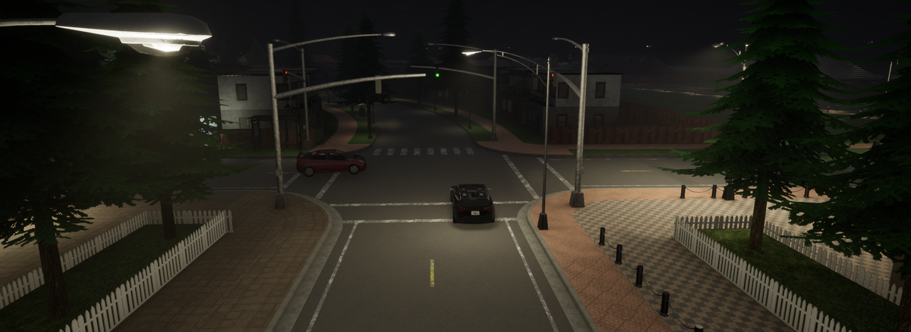
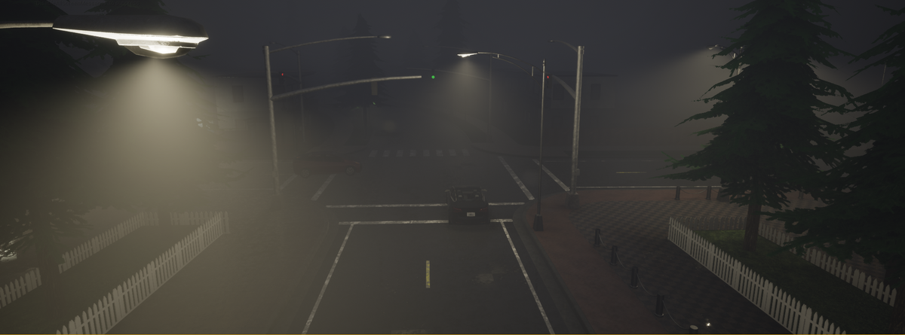
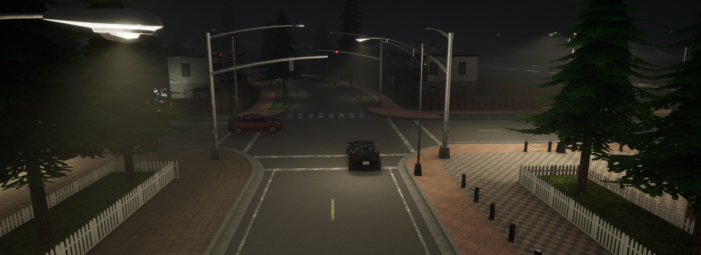

# 03. Urban Intersection — Red Light Failure

**ID:** `03_VID_FTSI` | **Date:** September 10, 2023 | **Location:** Urban intersection

## Incident Summary

| Field | Detail |
|-------|--------|
| Vehicle | Tesla Model S |
| AV System | Autopilot |
| Speed at Impact | ~3.7 mph (~6 km/h) |
| Original Weather | Clear |
| Original Lighting | Daylight |
| Video Duration | 4 sec @ 30 fps (1920×1080) |
| CARLA Map | Town04 |

A Tesla Model S on Autopilot failed to stop at a red light at an urban intersection. The vehicle proceeded through the signal at low speed, demonstrating a failure of the traffic light detection and response system. This incident was documented as part of the WSJ investigation into Tesla Autopilot failures at intersections.

**Notes:** WSJ Investigation — Original video 3.

**Source:** [WSJ — Tesla Autopilot Crash Investigation](https://www.wsj.com/business/autos/tesla-autopilot-crash-investigation-997b0129)

---

## CARLA Simulation

| Parameter | Value |
|-----------|-------|
| Map | Town04 |
| Origin | x=204, y=-227, z=0.65 |
| Destination | x=204, y=-261, z=0.65 |

### Environmental Variations

| Noon — Clear | Noon — Rain | Noon — Fog |
|:---:|:---:|:---:|
|  |  |  |

| Twilight — Clear | Twilight — Rain | Twilight — Fog |
|:---:|:---:|:---:|
|  |  |  |

| Night — Clear | Night — Rain | Night — Fog |
|:---:|:---:|:---:|
|  |  |  |

---

[Back to Dataset Overview](../README.md)
