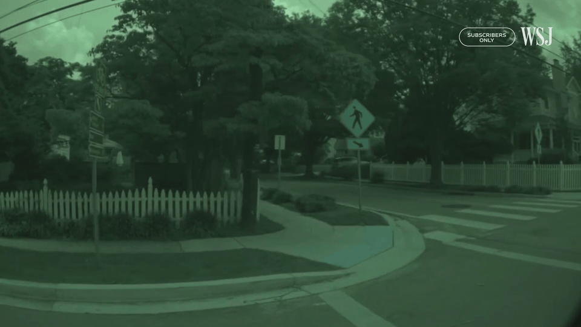

# 03. Urban Intersection — Red Light Failure

**ID:** `03_VID_FTSI` | **Date:** September 10, 2023 | **Location:** Urban intersection

## Incident Summary

| Field | Detail |
|-------|--------|
| Vehicle | Tesla Model S |
| AV System | Autopilot |
| Speed at Impact | ~3.7 mph (~6 km/h) |
| Original Weather | Clear |
| Original Lighting | Daylight |
| Video Duration | 4 sec @ 30 fps (1920×1080) |
| CARLA Map | TBD |

> *Simulation GIF to be generated from `Videos/03_VID_FTSI/AVC-FTSI.mp4`.*

A Tesla Model S on Autopilot failed to stop at a red light at an urban intersection. The vehicle proceeded through the signal at low speed, demonstrating a failure of the traffic light detection and response system. This incident was documented as part of the WSJ investigation into Tesla Autopilot failures at intersections.

**Notes:** WSJ Investigation — Original video 3.

**Source:** [WSJ — Tesla Autopilot Crash Investigation](https://www.wsj.com/business/autos/tesla-autopilot-crash-investigation-997b0129)

---

## CARLA Simulation

| Parameter | Value |
|-----------|-------|
| Map | TBD |
| Origin | TBD |
| Destination | TBD |

> *CARLA simulation coordinates to be added.*

### Environmental Variations

> *CARLA simulation screenshots coming soon.*

---

[Back to Dataset Overview](../README.md)
