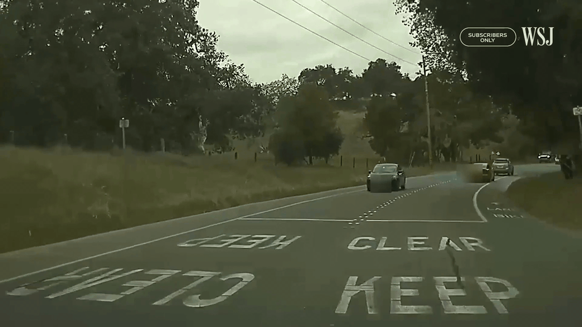
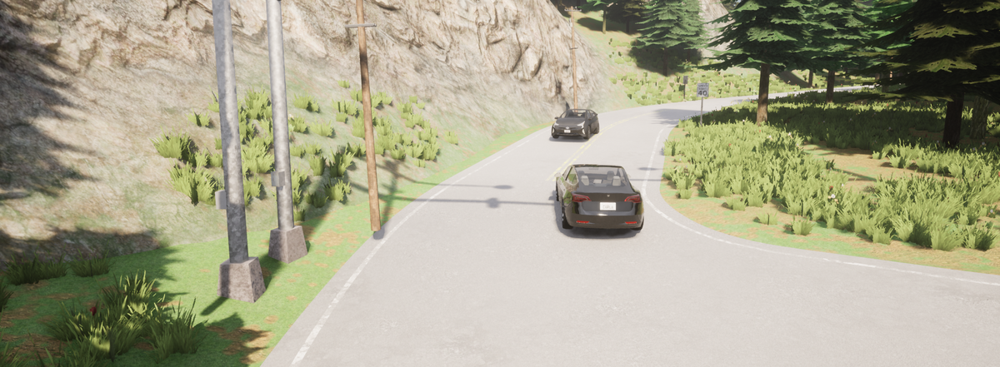
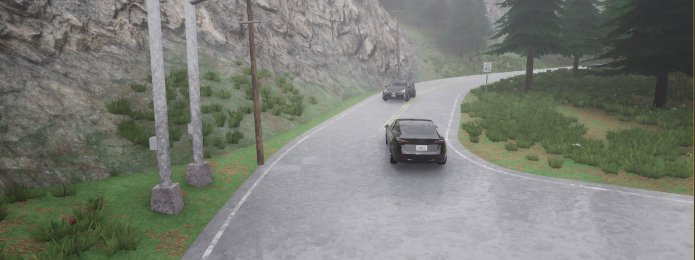
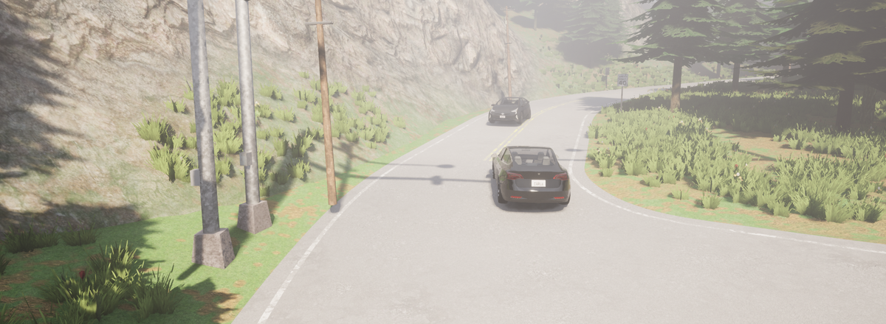
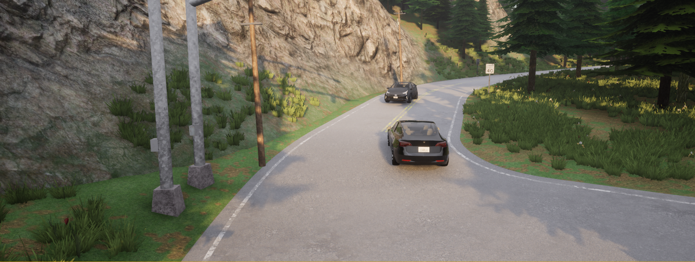
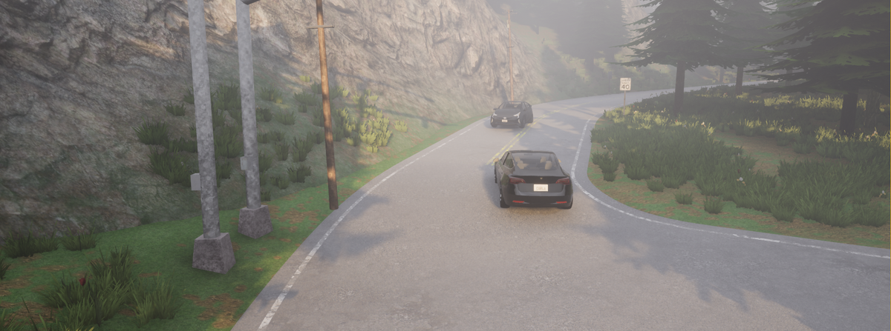
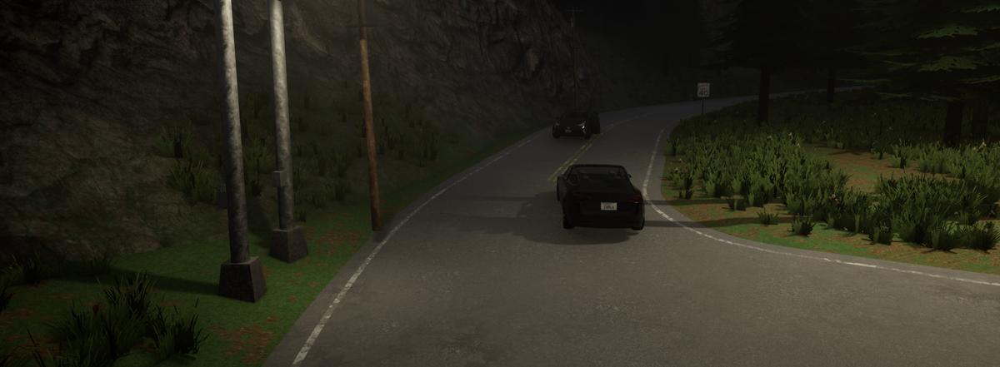
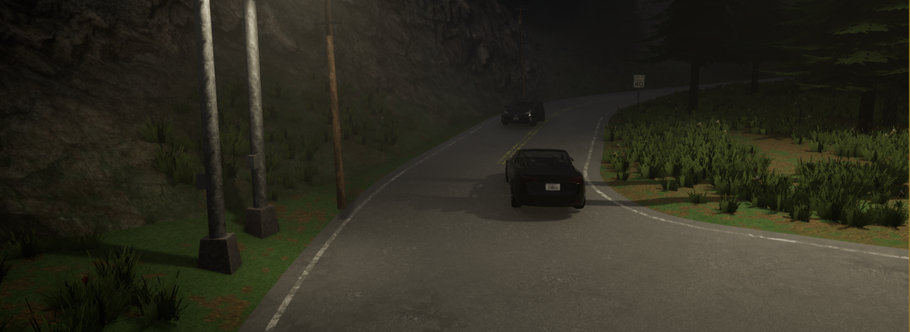

# 04. US-101 — Highway Lane Departure

**ID:** `04_VID_LV` | **Date:** July 28, 2023 | **Location:** Highway US-101

## Incident Summary

| Field | Detail |
|-------|--------|
| Vehicle | Tesla Model 3 |
| AV System | Autopilot |
| Speed at Impact | ~54.6 mph (~88 km/h) |
| Original Weather | Clear |
| Original Lighting | Daylight |
| Video Duration | 6 sec @ 30 fps (1920×1080) |
| CARLA Map | Town07 |

A Tesla Model 3 on Autopilot departed its lane on Highway US-101 at highway speed. The vehicle drifted from its lane without correction, demonstrating a failure in lane-keeping assistance. This incident was documented as part of the WSJ investigation into Tesla Autopilot lane-keeping failures.

**Notes:** WSJ Investigation — Original video 4.

**Source:** [WSJ — Tesla Autopilot Crash Investigation](https://www.wsj.com/business/autos/tesla-autopilot-crash-investigation-997b0129)

---

## CARLA Simulation

| Parameter | Value |
|-----------|-------|
| Map | Town07 |
| Origin | x=11.5, y=-238, z=0.76 |
| Destination | x=40.78, y=-203, z=5 |

### Environmental Variations

| Noon — Clear | Noon — Rain | Noon — Fog |
|:---:|:---:|:---:|
|  |  |  |

| Twilight — Clear | Twilight — Rain | Twilight — Fog |
|:---:|:---:|:---:|
|  |  |  |

| Night — Clear | Night — Rain | Night — Fog |
|:---:|:---:|:---:|
|  |  |  |

---

[Back to Dataset Overview](../README.md)
