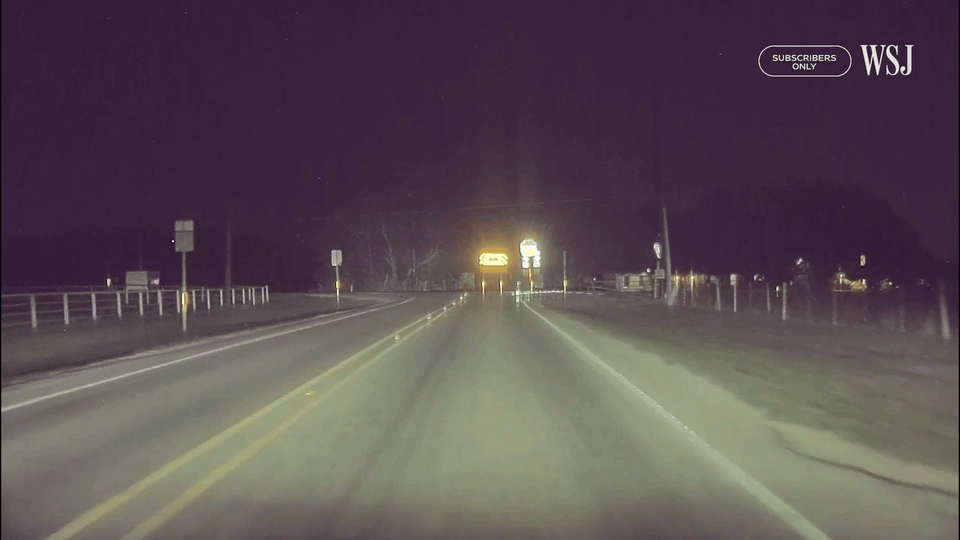
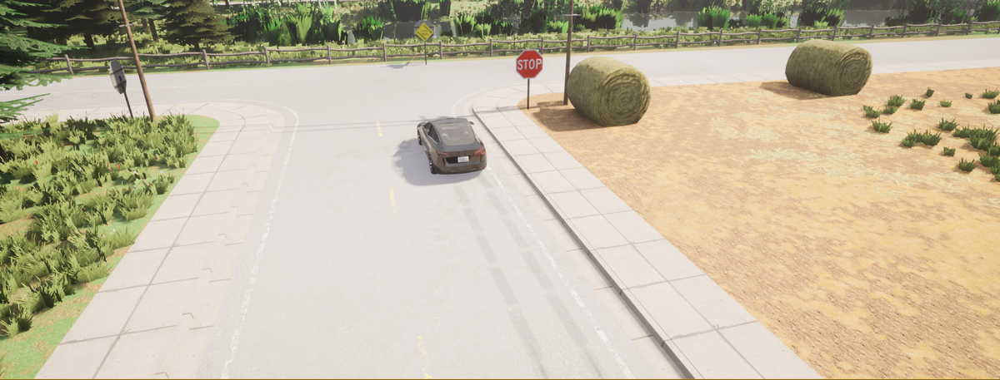
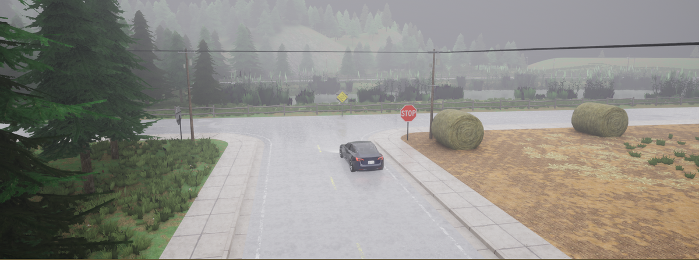
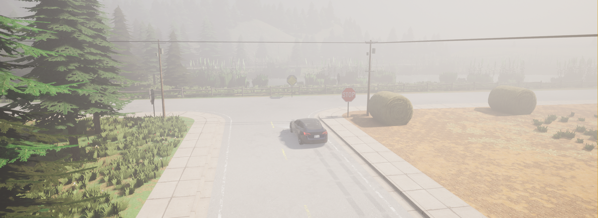
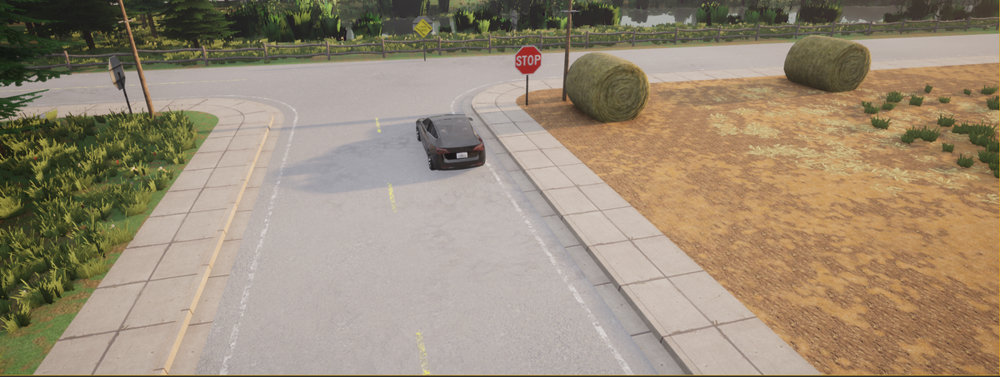
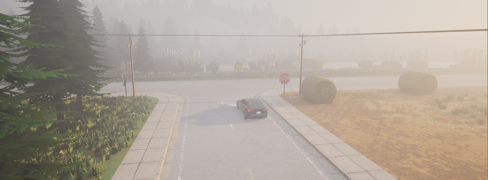
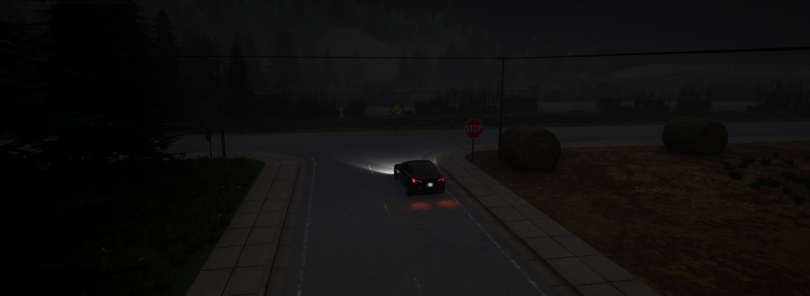
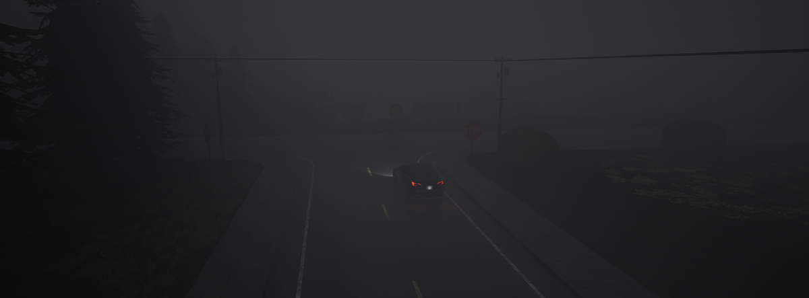
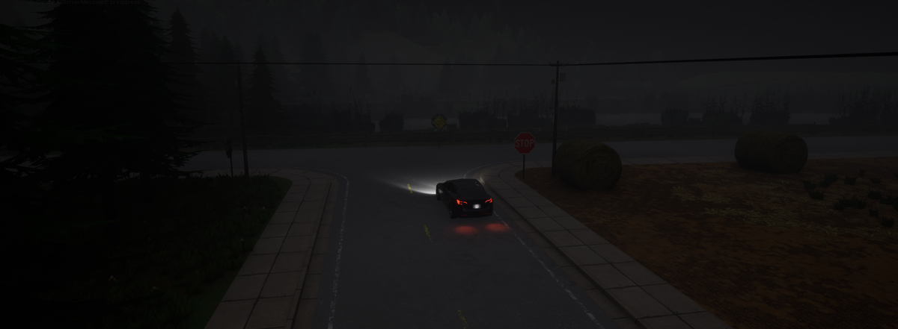

# 05. Off-Road Hazard Departure

**ID:** `05_VID_ORS` | **Date:** May 14, 2023 | **Location:** Unknown

## Incident Summary

| Field | Detail |
|-------|--------|
| Vehicle | Tesla Model Y |
| AV System | Autopilot |
| Speed at Impact | ~50.86 mph (~82 km/h) |
| Original Weather | Clear |
| Original Lighting | Daylight |
| Video Duration | 6 sec @ 30 fps (1920×1080) |
| CARLA Map | Town04 |




A Tesla Model Y on Autopilot departed the road surface toward an off-road hazard. The vehicle failed to maintain its lane and veered off the road edge. This incident was documented as part of the WSJ investigation into Tesla Autopilot road departure failures.

**Notes:** WSJ Investigation — Original video 5.

**Source:** [WSJ — Tesla Autopilot Crash Investigation](https://www.wsj.com/business/autos/tesla-autopilot-crash-investigation-997b0129)

---

## CARLA Simulation

| Parameter | Value |
|-----------|-------|
| Map | Town07 |
| Origin | x=298, y=85, z=0.1 |
| Destination | x=296.78, y=131.63, z=4.96 |

### Environmental Variations

| Noon — Clear | Noon — Rain | Noon — Fog |
|:---:|:---:|:---:|
|  |  |  |

| Twilight — Clear | Twilight — Rain | Twilight — Fog |
|:---:|:---:|:---:|
|  |  |  |

| Night — Clear | Night — Rain | Night — Fog |
|:---:|:---:|:---:|
|  |  |  |

### Simulation Script

The CARLA reconstruction script for this scenario is [`scripts/05_VID_ORS_scenario.py`](../scripts/05_VID_ORS_scenario.py).

**Prerequisites:** CARLA 0.9.x running locally with PythonAPI configured.

**Run:**
```bash
# Place inside your CARLA PythonAPI directory tree, then:
python 05_VID_ORS_scenario.py
```

Output frames and `metadata.jsonl` are saved to `./sessions/<timestamp>/`.

---

[Back to Dataset Overview](../README.md)
