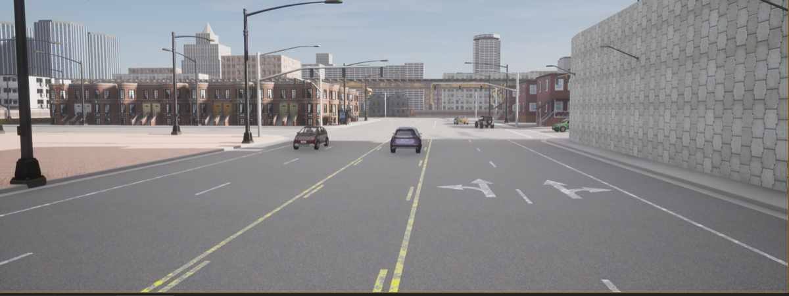
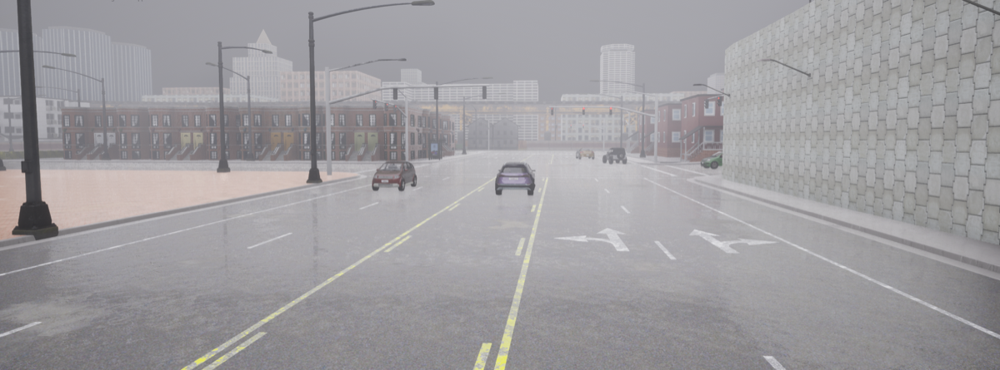
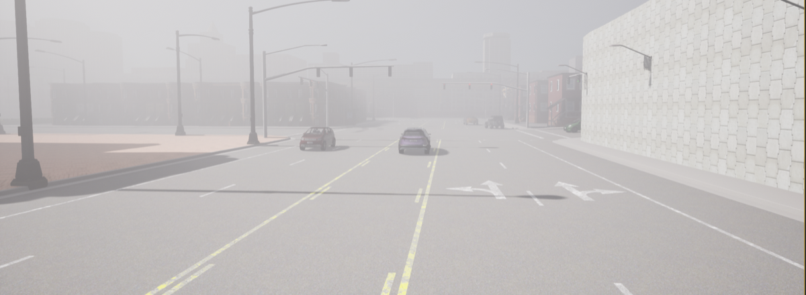
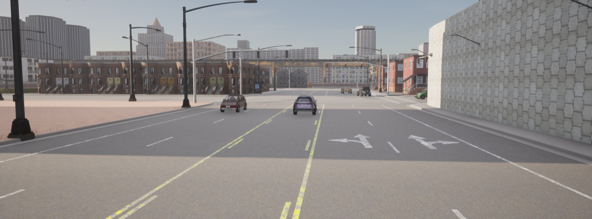
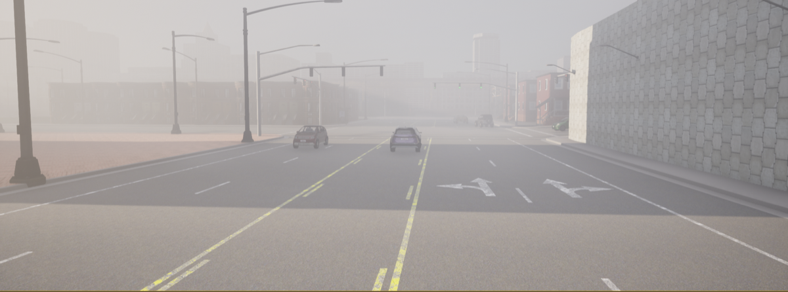
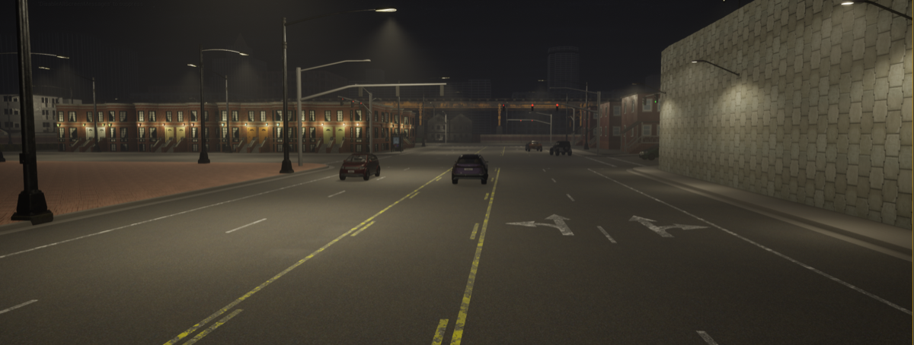
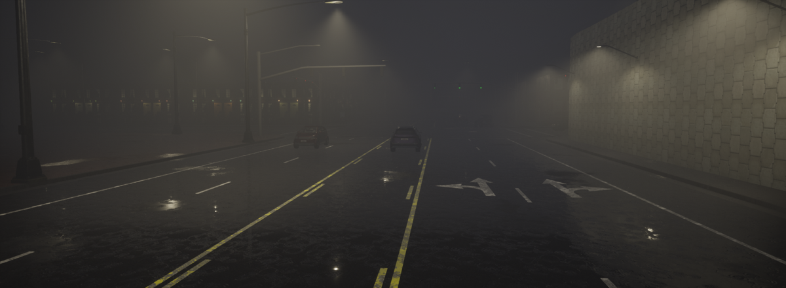
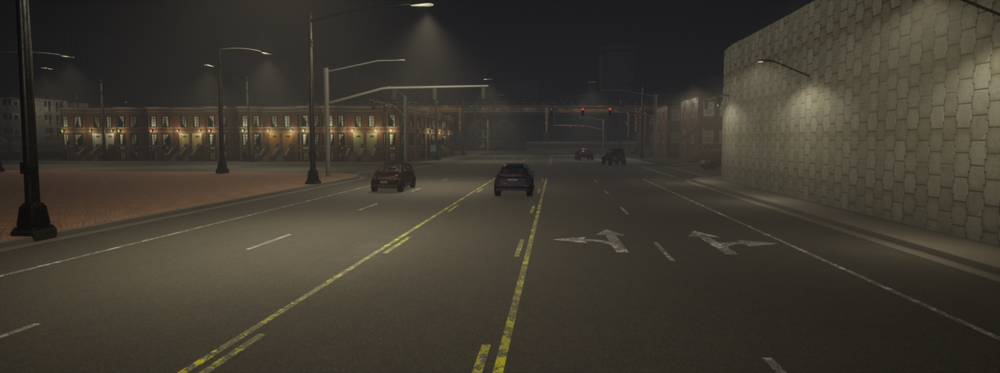

# 07. Urban — Tesla Robotaxi Failed Left Turn

**ID:** `07_VID_ROBO` | **Date:** June 22, 2025 | **Location:** Urban

## Incident Summary

| Field | Detail |
|-------|--------|
| Vehicle | Tesla Robotaxi |
| AV System | Autonomous (FSD V14.3) |
| Speed at Impact | ~21 mph (~34 km/h) |
| Original Weather | Clear |
| Original Lighting | Daylight |
| Video Duration | 20 sec @ 30 fps (1280×720) |
| CARLA Map | Town03 |

> *Simulation GIF to be generated from `Videos/07_VID_ROBO/07_VID_ROBO.mp4`.*

A Tesla Robotaxi operating in fully autonomous mode (FSD V14.3) failed to execute a left turn correctly during its first day of public operation, resulting in a significant driving error. The incident was captured by a passenger and shared on Reddit, highlighting unexpected behavior in the Robotaxi's first-day deployment.

**Notes:** Reddit — Robotaxi test incident.

**Source:** [Reddit — Tesla Robotaxi Day 1 significant screwup](https://www.reddit.com/r/SelfDrivingCars/comments/1li2cil/tesla_robotaxi_day_1_significant_screwup_not_oc/)

---

## CARLA Simulation

| Parameter | Value |
|-----------|-------|
| Map | Town03 |
| Origin | `x=4.53, y=-33.92, z=4.73, yaw=-94.90, pitch=-15.12, roll=0.00` |
| Destination | `x=3.45, y=-132.85, z=1.58, yaw=-90.65, pitch=-0.70, roll=0.00` |

### Environmental Variations

| Noon — Clear | Noon — Rain | Noon — Fog |
|:---:|:---:|:---:|
|  |  |  |

| Twilight — Clear | Twilight — Rain | Twilight — Fog |
|:---:|:---:|:---:|
|  |  |  |

| Night — Clear | Night — Rain | Night — Fog |
|:---:|:---:|:---:|
|  |  |  |

---

[Back to Dataset Overview](../README.md)
