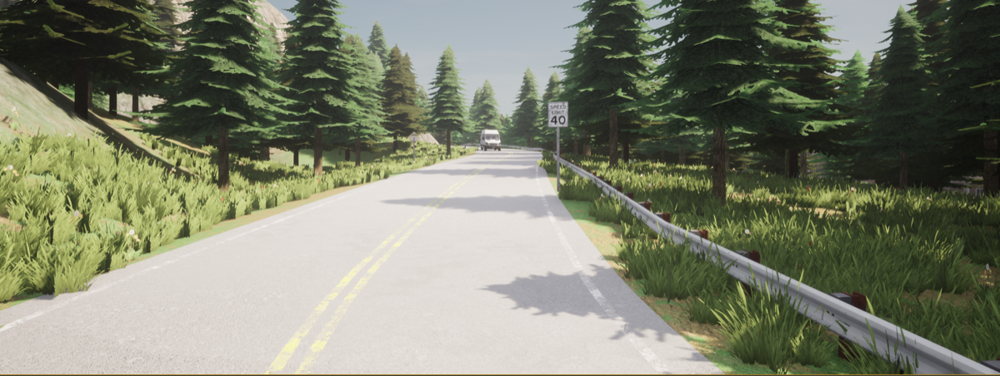
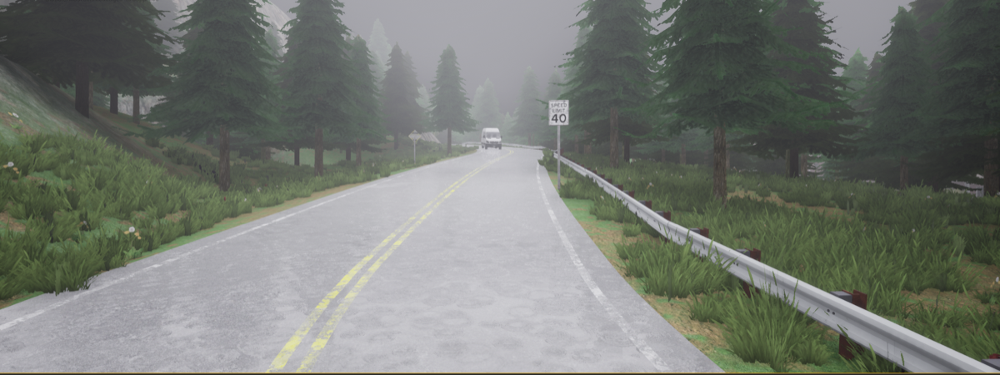
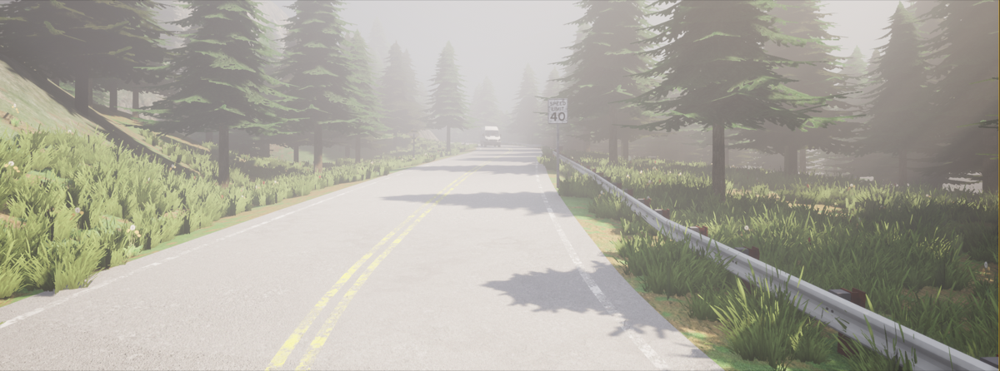
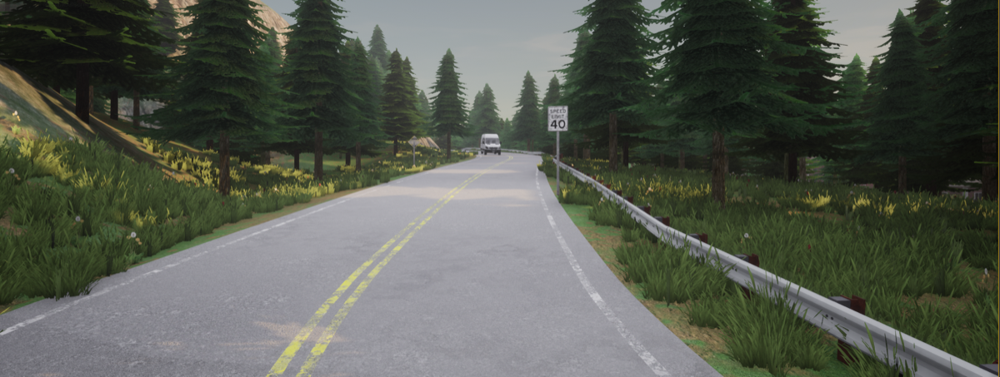
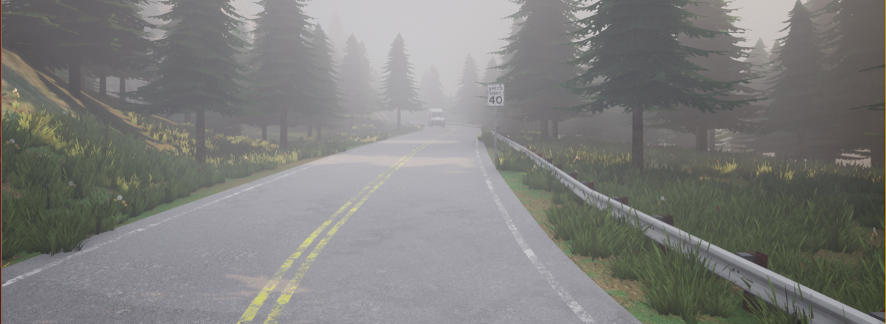
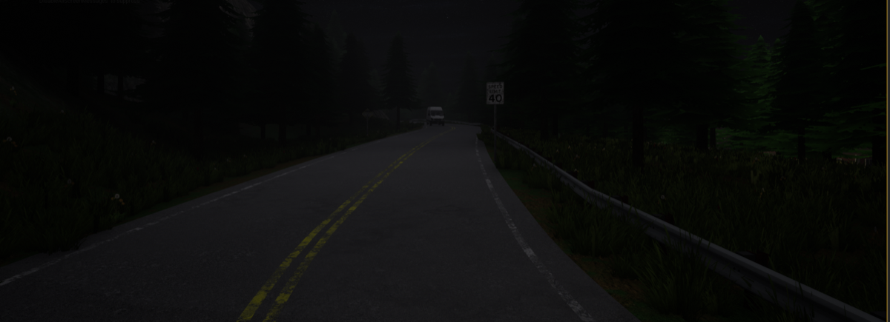
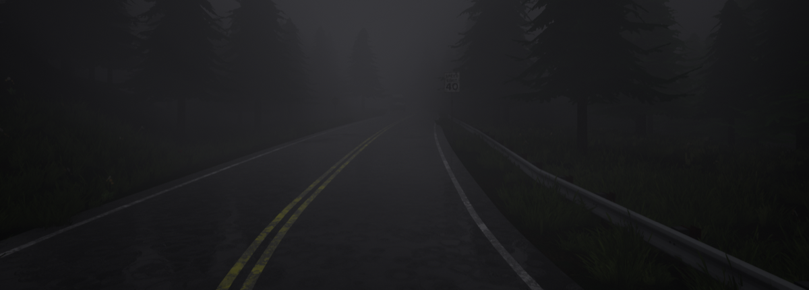
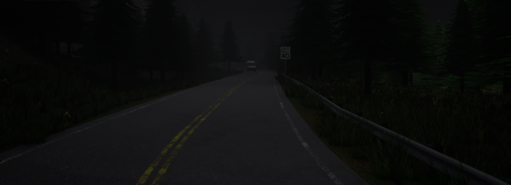

# 08. Rural Highway — Model 3 FSD Tree Crash

**ID:** `08_VID_M3` | **Date:** February 27, 2025 | **Location:** Rural highway

## Incident Summary

| Field | Detail |
|-------|--------|
| Vehicle | Tesla Model 3 |
| AV System | FSD |
| AV Version | v13.2.8 |
| Speed at Impact | ~45 mph (~72 km/h) |
| Original Weather | Clear |
| Original Lighting | Daylight |
| Video Duration | 37 sec @ 30 fps (1668×1080) |
| CARLA Map | Town07 |

> *Simulation GIF to be generated from `Videos/08_VID_M3/08_VID_M3.mp4`.*

A Tesla Model 3 operating under FSD v13.2.8 abruptly swerved left on a rural highway and crashed into a tree. The dashcam footage clearly shows the unexpected steering input with no apparent cause. The incident prompted scrutiny of FSD v13.2.8's behavior on rural roads with unclear lane markings.

**Notes:** YouTube — FSD 13.2.8 crash footage.

**Source:** [YouTube — Tesla Model 3 FSD crash](https://www.youtube.com/watch?v=frGoalySCns)

---

## CARLA Simulation

| Parameter | Value |
|-----------|-------|
| Map | Town07 |
| Origin | `x=13.63, y=-238.25, z=0.88, yaw=20.63, pitch=-0.05, roll=0.00` |
| Destination | `x=58.30, y=-156.06, z=9.46, yaw=41.39, pitch=4.95, roll=0.00` |

### Environmental Variations

| Noon — Clear | Noon — Rain | Noon — Fog |
|:---:|:---:|:---:|
|  |  |  |

| Twilight — Clear | Twilight — Rain | Twilight — Fog |
|:---:|:---:|:---:|
|  |  |  |

| Night — Clear | Night — Rain | Night — Fog |
|:---:|:---:|:---:|
|  |  |  |

---

[Back to Dataset Overview](../README.md)
