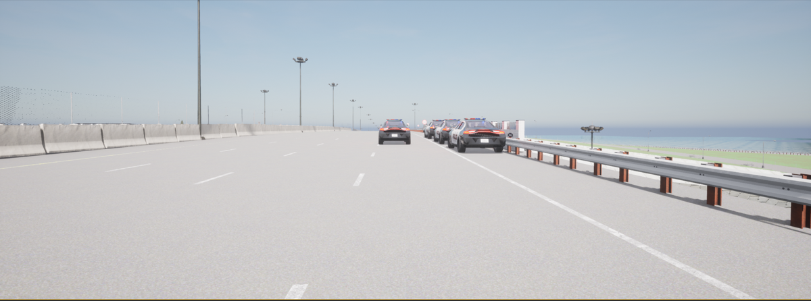
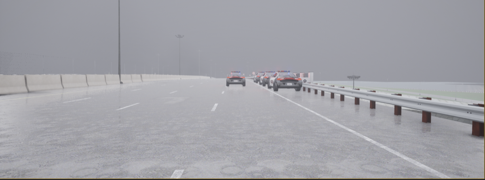
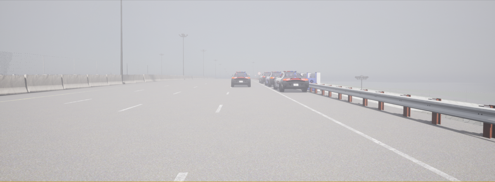
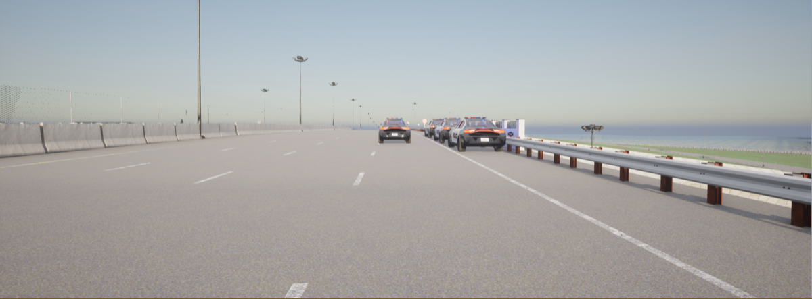
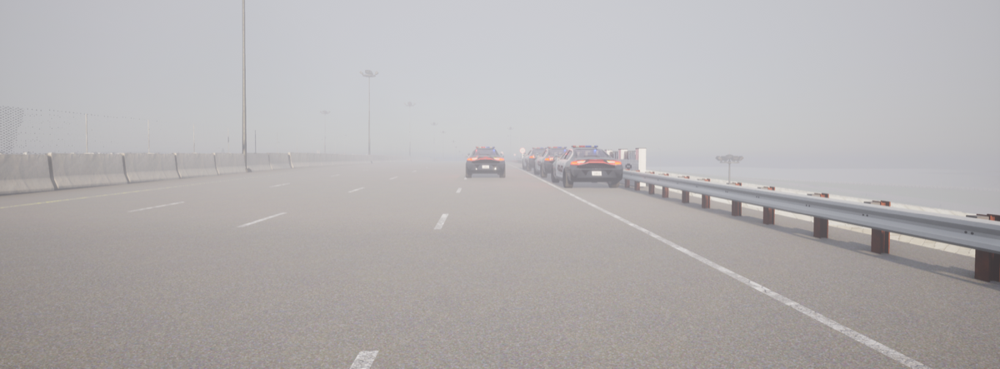
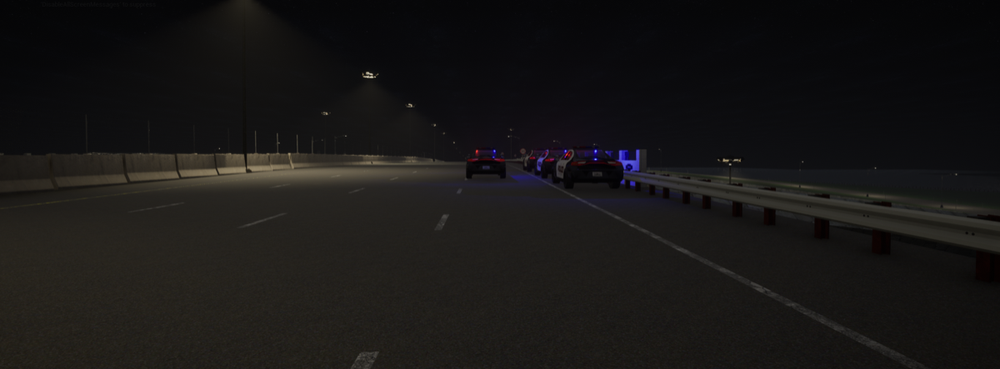
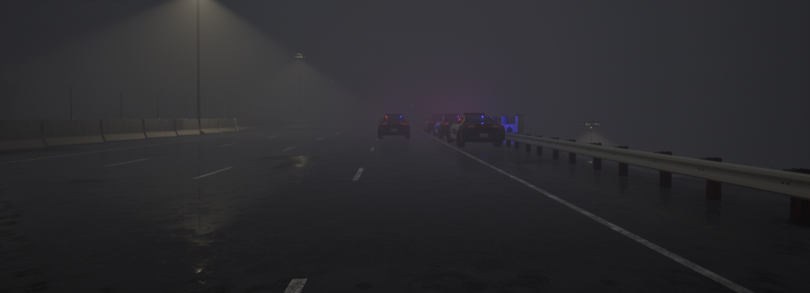
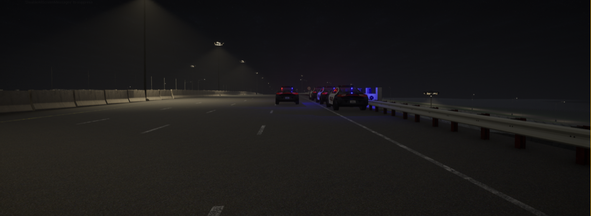

# 09. Highway — High-Speed Nighttime Collision

**ID:** `09_VID_CRASH` | **Date:** February 27, 2021 | **Location:** Highway

## Incident Summary

| Field | Detail |
|-------|--------|
| Vehicle | Tesla Model X |
| AV System | Autopilot |
| Speed at Impact | ~54 mph (~87 km/h) |
| Original Weather | Clear |
| Original Lighting | Night |
| Video Duration | 8 sec @ 30 fps (1920×1080) |
| CARLA Map | Town04 |

> *Simulation GIF to be generated from `Videos/09_VID_CRASH/09_VID_CRASH.mp4`.*

A Tesla Model X on Autopilot was involved in a high-speed collision on a highway at night. The vehicle failed to detect and respond to an obstacle or vehicle ahead under low-light conditions, resulting in a crash. The incident was captured in news archive footage.

**Notes:** News archive footage.

**Source:** [YouTube — High-speed Tesla Autopilot crash](https://www.youtube.com/watch?v=V2u3dcH2VGM)

---

## CARLA Simulation

| Parameter | Value |
|-----------|-------|
| Map | Town04 |
| Origin | `x=-76.94, y=37.49, z=11.12, yaw=-3.32, pitch=-3.78, roll=0.00` |
| Destination | `x=-22.69, y=36.72, z=11.35, yaw=1.99, pitch=-0.64, roll=0.00` |

### Environmental Variations

| Noon — Clear | Noon — Rain | Noon — Fog |
|:---:|:---:|:---:|
|  |  |  |

| Twilight — Clear | Twilight — Rain | Twilight — Fog |
|:---:|:---:|:---:|
|  |  |  |

| Night — Clear | Night — Rain | Night — Fog |
|:---:|:---:|:---:|
|  |  |  |

---

[Back to Dataset Overview](../README.md)
