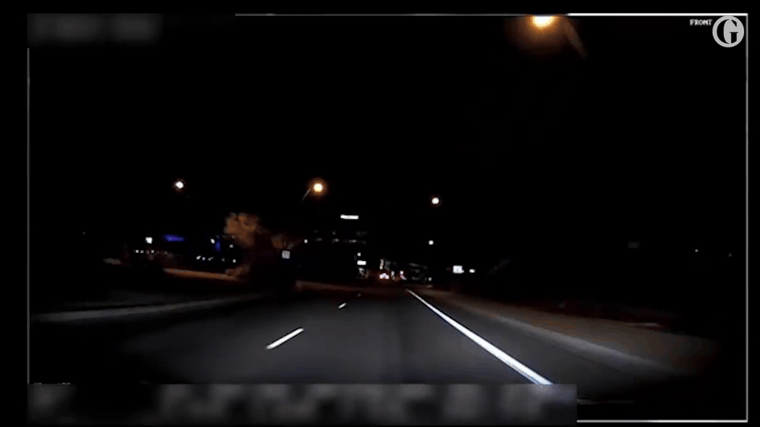
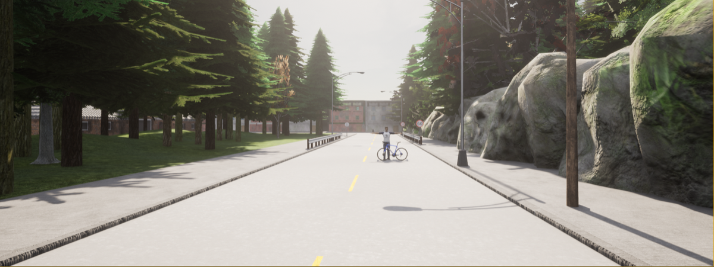
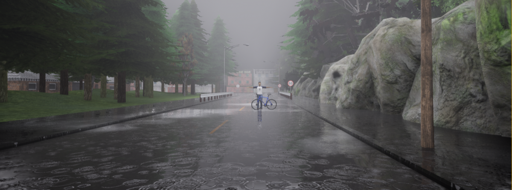
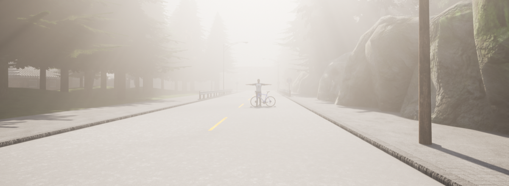
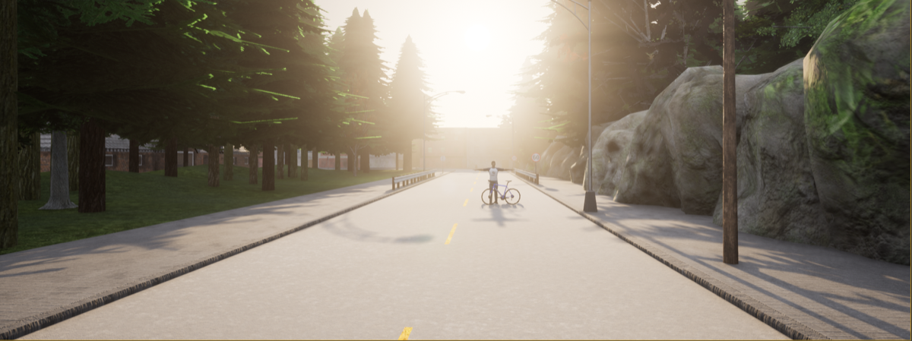
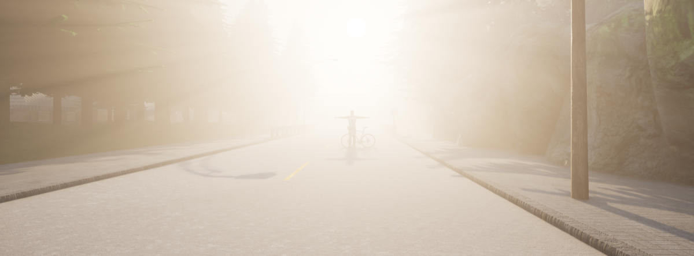
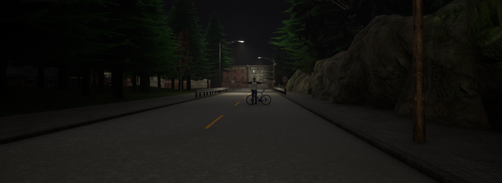
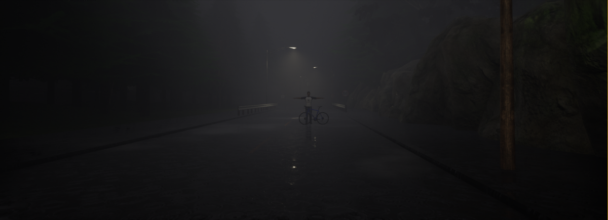
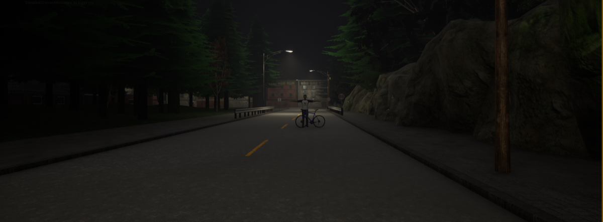

# 10. Highway — Nighttime Pedestrian Fatality

**ID:** `10_VID_BIKE` | **Date:** March 18, 2018 | **Location:** Highway

## Incident Summary

| Field | Detail |
|-------|--------|
| Vehicle | Various Tesla models |
| AV System | Autopilot |
| Speed at Impact | ~38 mph (~61 km/h) |
| Original Weather | Clear |
| Original Lighting | Night |
| Video Duration | 6 sec @ 25 fps (1920×1080) |
| CARLA Map | Town02 |




A self-driving vehicle on Autopilot struck a pedestrian crossing the highway at night. The AV system failed to detect the pedestrian in time to brake or avoid the collision under low-light conditions. This scenario reconstructs the dynamics of nighttime pedestrian detection failure in autonomous vehicles.

**Notes:** WSJ video report.

**Source:** [The Guardian — Self-driving car Uber death](https://www.theguardian.com/technology/2018/mar/22/self-driving-car-uber-death-woman-failure-fatal-crash-arizona)

---

## CARLA Simulation

| Parameter | Value |
|-----------|-------|
| Map | Town02 |
| Origin | `x=142.40, y=105.10, z=2.74, yaw=177.57, pitch=-9.12, roll=0.00` |
| Destination | `x=97.44, y=105.90, z=1.81, yaw=-179.69, pitch=-3.54, roll=0.00` |

### Environmental Variations

| Noon — Clear | Noon — Rain | Noon — Fog |
|:---:|:---:|:---:|
|  |  |  |

| Twilight — Clear | Twilight — Rain | Twilight — Fog |
|:---:|:---:|:---:|
|  |  |  |

| Night — Clear | Night — Rain | Night — Fog |
|:---:|:---:|:---:|
|  |  |  |

### Simulation Script

The CARLA reconstruction script for this scenario is [`scripts/10_VID_BIKE_scenario.py`](../scripts/10_VID_BIKE_scenario.py).

**Prerequisites:** CARLA 0.9.x running locally with PythonAPI configured.

**Run:**
```bash
# Place inside your CARLA PythonAPI directory tree, then:
python 10_VID_BIKE_scenario.py
```

Output frames and `metadata.jsonl` are saved to `./sessions/<timestamp>/`.

---

[Back to Dataset Overview](../README.md)
