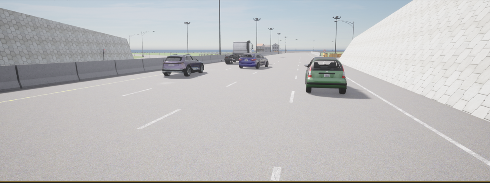
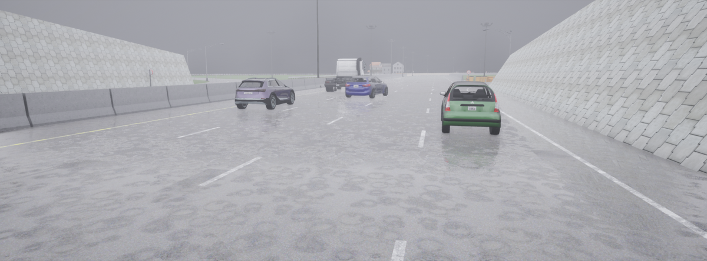
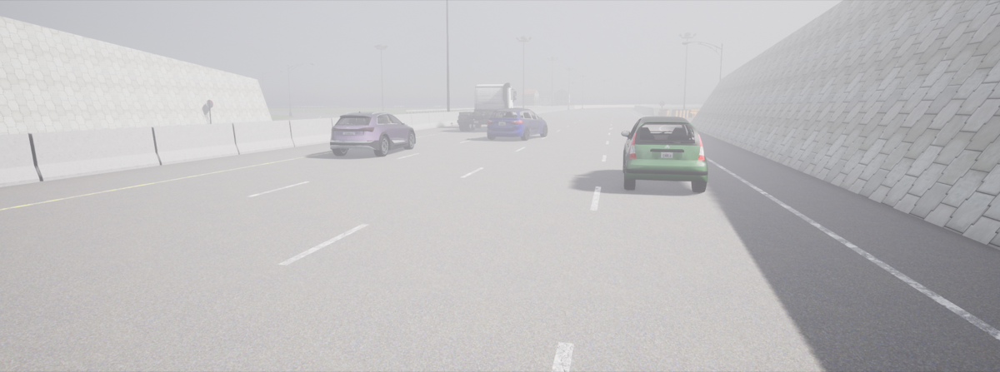
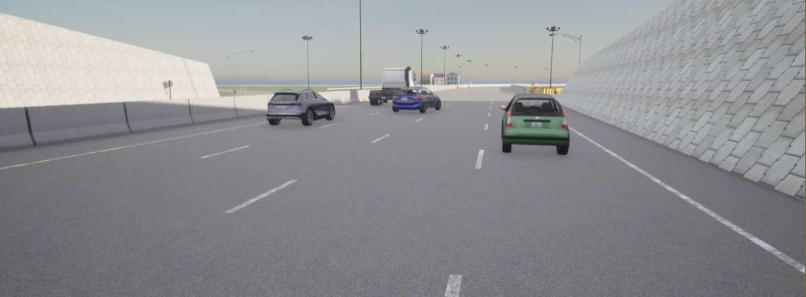
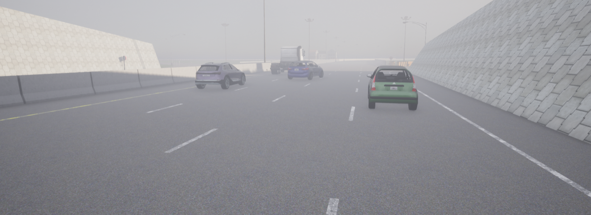
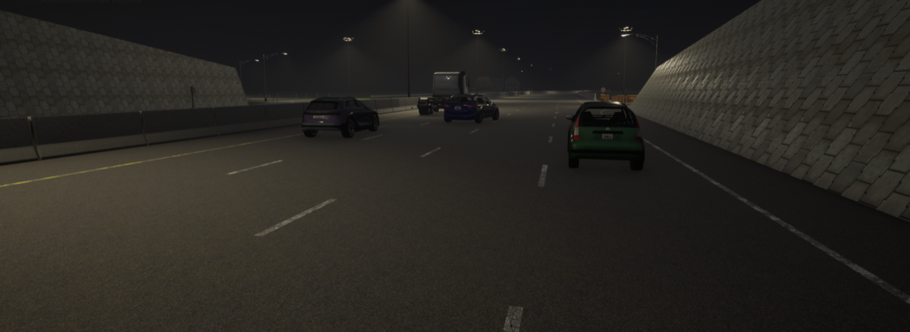
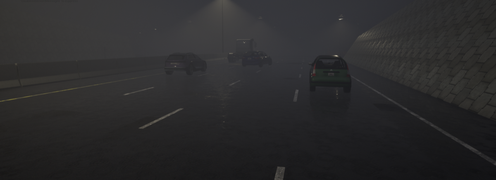
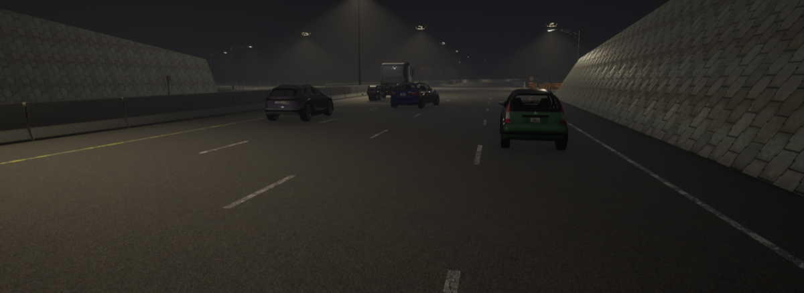

# 11. Handan, China — Stationary Street Sweeper

**ID:** `11_REP_HAND` | **Date:** January 20, 2016 | **Location:** Handan, Hebei, China

## Incident Summary

| Field | Detail |
|-------|--------|
| Vehicle | Tesla Model S |
| AV System | Autopilot |
| Speed at Impact | ~62 mph (~100 km/h) |
| Original Weather | Clear |
| Original Lighting | Daylight |
| Outcome | Fatal collision |
| CARLA Map | Town04 |


A Tesla Model S operating under Autopilot failed to reduce speed when approaching a stationary street sweeper stopped on the highway shoulder, resulting in a fatal collision. Dashcam footage confirmed the obstacle's presence well in advance of the crash. This was the first publicly reported Autopilot fatality in China.

**Notes:** First reported Autopilot fatality in China; dashcam footage confirmed obstacle presence.

**Sources:**
- [CNET — Dashcam shows fatal Tesla Model S crash in China](https://www.cnet.com/news/dash-cam-showed-fatal-tesla-crash-in-china/)
- [New York Times — Autopilot Cited in Death of Chinese Tesla Driver](https://www.nytimes.com/2016/09/15/business/fatal-tesla-crash-in-china-involved-autopilot-government-tv-says.html)
- [Electrek — Another fatal Tesla crash reportedly on Autopilot](https://electrek.co/2016/09/14/another-fatal-tesla-autopilot-crash-emerges-model-s-hits-a-streetsweeper-truck-caught-on-dashcam/)
- [Financial Times — Tesla sued in China over fatal crash](https://www.ft.com/content/80c45ad6-7ef0-11e6-bc52-0c7211ef3198)
- [Jalopnik — Two Years On, A Father Is Still Fighting Tesla Over Autopilot](https://jalopnik.com/two-years-on-a-father-is-still-fighting-tesla-over-aut-1823189786)
- [CCTV — Chinese state TV report (Chinese)](http://tv.cctv.com/2018/02/28/VIDEqktboPy3YMXacj6QTQFh180228.shtml)
- [ECNS — Tesla confirms Autopilot engaged in fatal crash in China](http://www.ecns.cn/2018/02-28/293992.shtml)

---

## CARLA Simulation

| Parameter | Value |
|-----------|-------|
| Map | Town04 |
| Origin | `x=-5.79, y=87.70, z=1.97, yaw=90.54, pitch=-27.72, roll=0.00` |
| Destination | `x=-5.57, y=8.05, z=0.71, yaw=90.65, pitch=1.01, roll=0.00` |

### Environmental Variations

| Noon — Clear | Noon — Rain | Noon — Fog |
|:---:|:---:|:---:|
|  |  |  |

| Twilight — Clear | Twilight — Rain | Twilight — Fog |
|:---:|:---:|:---:|
|  |  |  |

| Night — Clear | Night — Rain | Night — Fog |
|:---:|:---:|:---:|
|  |  |  |

### Simulation Script

The CARLA reconstruction script for this scenario is [`scripts/11_REP_HAND_scenario.py`](../scripts/11_REP_HAND_scenario.py).

**Prerequisites:** CARLA 0.9.x running locally with PythonAPI configured.

**Run:**
```bash
# Place inside your CARLA PythonAPI directory tree, then:
python 11_REP_HAND_scenario.py
```

Output frames and `metadata.jsonl` are saved to `./sessions/<timestamp>/`.

---

[Back to Dataset Overview](../README.md)
