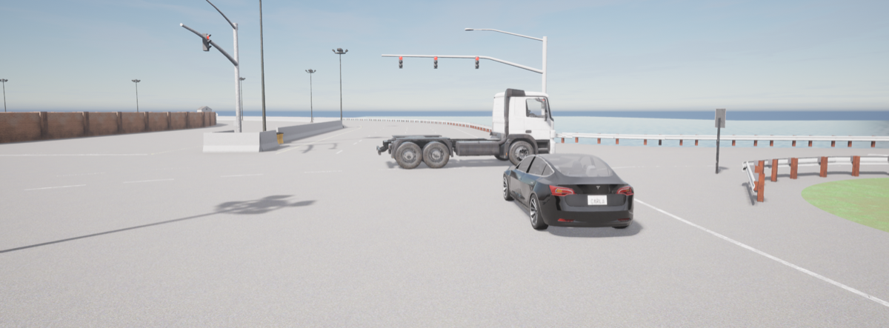
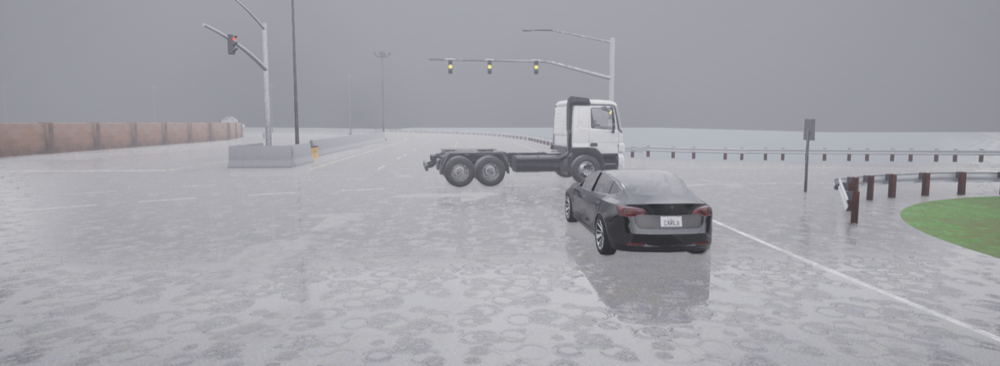
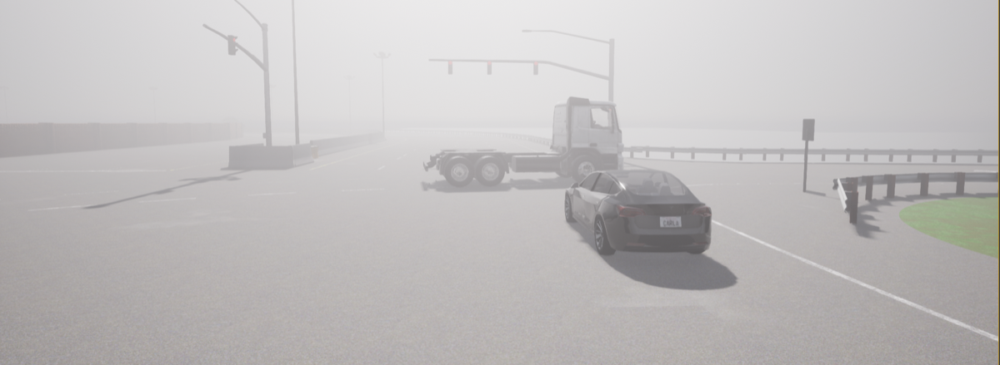
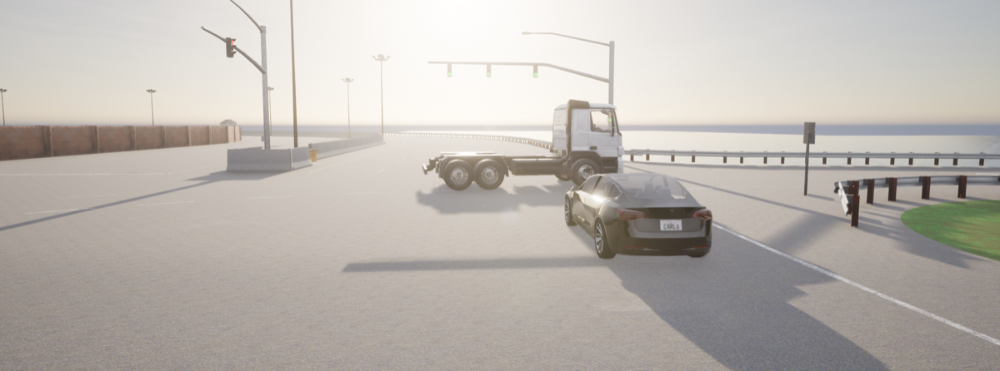

# 12. Williston, Florida — Left-Turning Semi-Trailer

**ID:** `12_REP_WILL` | **Date:** May 7, 2016 | **Location:** Williston, Florida, USA

## Incident Summary

| Field | Detail |
|-------|--------|
| Vehicle | Tesla Model S |
| AV System | Autopilot |
| Speed at Impact | ~65 mph (~105 km/h) |
| Original Weather | Clear |
| Original Lighting | Daylight |
| Outcome | Fatal collision |
| CARLA Map | Town04 |

A Tesla Model S on Autopilot failed to brake for an 18-wheel tractor-trailer making a left turn across the highway at an intersection. The vehicle drove under the trailer at highway speed, resulting in a fatal collision. This was the first Autopilot fatality in the United States, prompting a formal NHTSA investigation.

**Notes:** First Autopilot fatality in the US; NHTSA formal investigation opened.

**Source:** [The Guardian — Tesla autopilot death: self-driving car elon musk](https://www.theguardian.com/technology/2016/jun/30/tesla-autopilot-death-self-driving-car-elon-musk)

---

## CARLA Simulation

| Parameter | Value |
|-----------|-------|
| Map | Town04 |
| Origin | `x=-321.29, y=6.77, z=1.42, yaw=179.26, pitch=-11.99, roll=0.00` |
| Destination | `x=-379.17, y=6.07, z=0.77, yaw=-179.82, pitch=-0.95, roll=0.00` |

### Environmental Variations

| Noon — Clear | Noon — Rain | Noon — Fog |
|:---:|:---:|:---:|
|  |  |  |

| Twilight — Clear | Twilight — Fog | Night — Clear | Night — Rain | Night — Fog |
|:---:|:---:|:---:|:---:|:---:|
|  |  |  |  |  |

---

[Back to Dataset Overview](../README.md)
