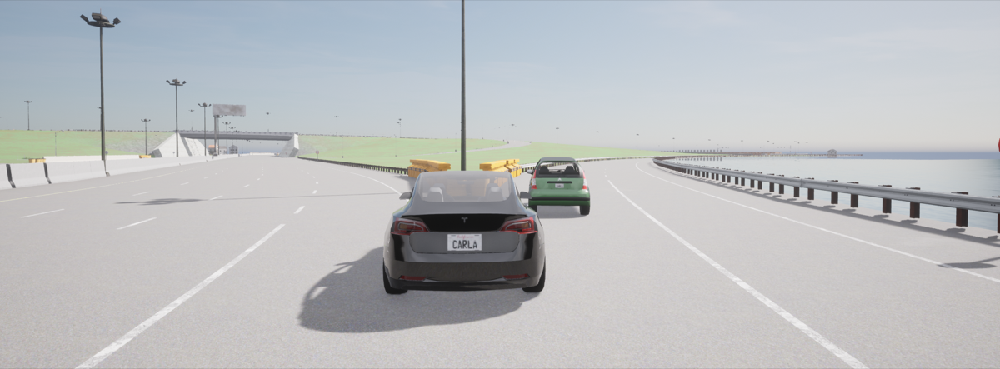
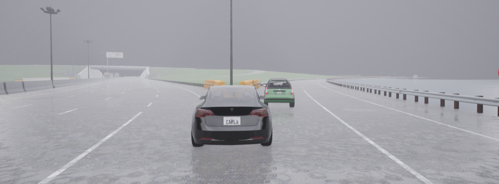
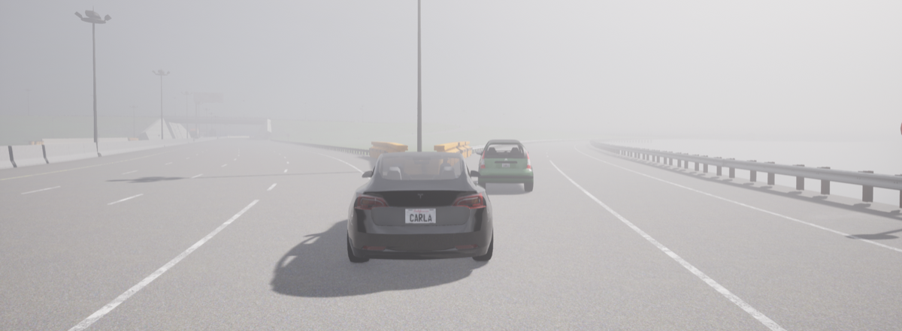
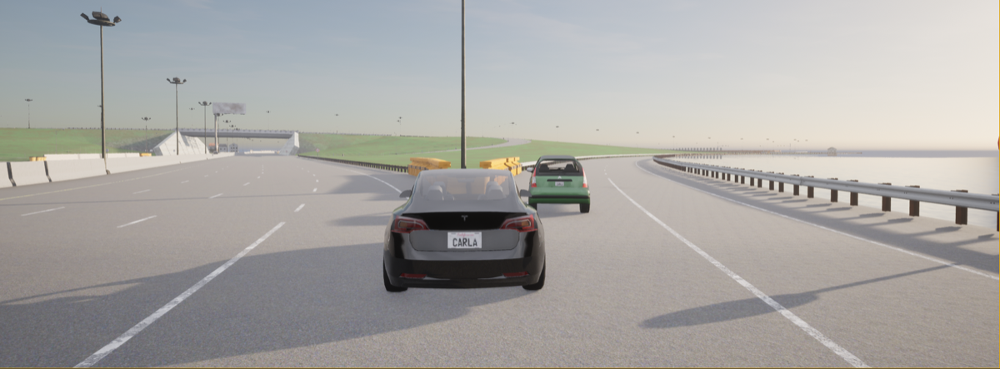
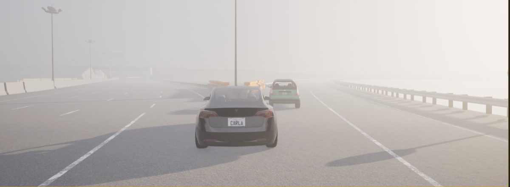
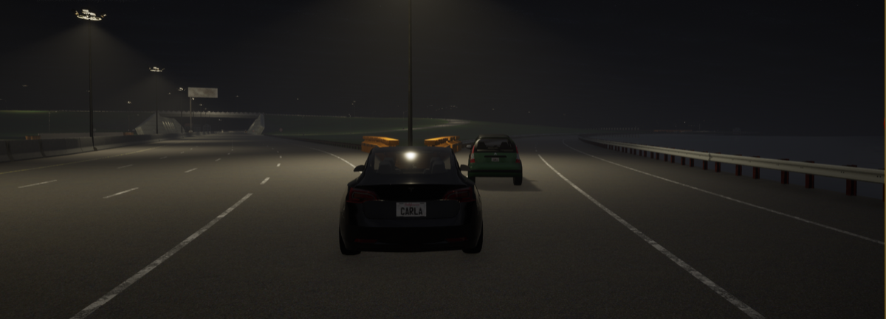
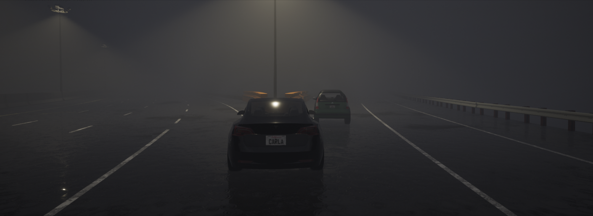
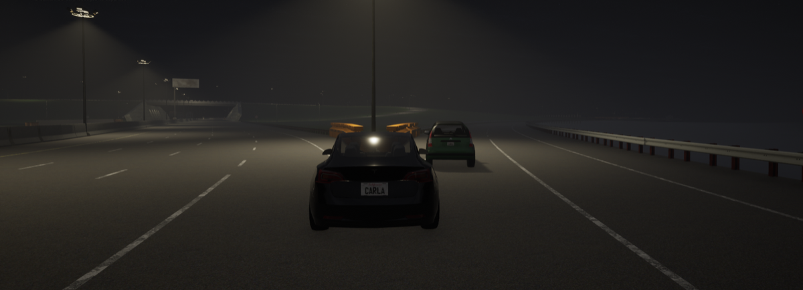

# 13. Mountain View, California — Highway Barrier

**ID:** `13_REP_MTV` | **Date:** March 23, 2018 | **Location:** Mountain View, California, USA

## Incident Summary

| Field | Detail |
|-------|--------|
| Vehicle | Tesla Model X |
| AV System | Autopilot |
| Speed at Impact | ~65 mph (~105 km/h) |
| Original Weather | Clear |
| Original Lighting | Daylight |
| Outcome | Fatal collision |
| CARLA Map | Town04 |

A Tesla Model X on Autopilot drifted into a concrete highway divider at a carpool lane exit and was subsequently struck by two following vehicles, resulting in a fatal collision. Both NHTSA and NTSB launched formal investigations. The driver was Apple software engineer Walter Huang.

**Notes:** NHTSA and NTSB investigations initiated; driver was Apple engineer Walter Huang.

**Sources:**
- [Reuters — Tesla says crashed vehicle had been on Autopilot prior to accident](https://www.reuters.com/article/us-tesla-crash/tesla-says-crashed-vehicle-had-been-on-autopilot-prior-to-accident-idUSKBN1H7023)
- [Tesla Blog — An Update on Last Week's Accident](https://www.tesla.com/blog/update-last-week%E2%80%99s-accident)
- [Ars Technica — Tesla says Autopilot was active during fatal crash in Mountain View](https://arstechnica.com/cars/2018/03/tesla-says-autopilot-was-active-during-fatal-crash-in-mountain-view/)
- [Ars Technica — Growing evidence Tesla's Autopilot handles lane dividers poorly](https://arstechnica.com/cars/2018/04/theres-growing-evidence-teslas-autopilot-handles-lane-dividers-poorly/)
- [Electrek — Tesla Autopilot confuses markings toward barrier](https://electrek.co/2018/04/03/tesla-autopilot-crash-barrier-markings-fatal-model-x-accident/)
- [ABC7 SF — Victim had complained about auto-pilot (I-TEAM exclusive)](http://abc7news.com/automotive/i-team-exclusive-victim-who-died-in-tesla-crash-had-complained-about-auto-pilot/3275600/)
- [Washington Post — NTSB 'unhappy' with Tesla release of investigative information](https://www.washingtonpost.com/news/dr-gridlock/wp/2018/04/01/ntsb-unhappy-with-tesla-release-of-investigative-information-in-fatal-crash/)
- [BBC — Tesla rebuked by death crash investigators](https://www.bbc.com/news/technology-43617752)
- [NTSB — Preliminary Report HWY18FH011 (PDF)](https://www.ntsb.gov/investigations/AccidentReports/Reports/HWY18FH011-preliminary.pdf)
- [NTSB — Safety Recommendation Report HSR1901 on crash attenuators (PDF)](https://www.ntsb.gov/investigations/AccidentReports/Reports/HSR1901.pdf)
- [NTSB — Press Release: Tesla Crash Investigation Yields 9 Safety Recommendations](https://www.ntsb.gov/news/press-releases/Pages/NR20200225.aspx)
- [NTSB — Final Report Abstract HWY18FH011 (PDF)](https://www.ntsb.gov/news/events/Documents/2020-HWY18FH011-BMG-abstract.pdf)
- [NTSB — Safety Recommendation H-17-041](https://www.ntsb.gov/_layouts/ntsb.recsearch/Recommendation.aspx?Rec=H-17-041)
- [NTSB — Safety Recommendation H-17-042](https://www.ntsb.gov/_layouts/ntsb.recsearch/Recommendation.aspx?Rec=H-17-042)
- [NTSB — Safety Recommendation Press Release (Sept 2019)](https://www.ntsb.gov/news/press-releases/Pages/NR20190909.aspx)
- [CNBC — Tesla settles lawsuit over Autopilot crash that killed Apple engineer (2024)](https://www.cnbc.com/2024/04/08/tesla-settles-wrongful-death-lawsuit-over-fatal-2018-autopilot-crash.html)
- [ABC7 Chicago — Tesla settles with Apple engineer Walter Huang's family](https://abc7chicago.com/tesla-settles-with-apple-engineer-walter-huangs-family-who-said-autopilot-caused-fatal-mountain-view-crash/14635870/)

---

## CARLA Simulation

| Parameter | Value |
|-----------|-------|
| Map | Town04 |
| Origin | `x=24.30, y=-332.70, z=1.10, yaw=122.02, pitch=-5.26, roll=0.00` |
| Destination | `x=-18.39, y=-249.01, z=0.99, yaw=112.65, pitch=-1.46, roll=0.00` |

### Environmental Variations

| Noon — Clear | Noon — Rain | Noon — Fog |
|:---:|:---:|:---:|
|  |  |  |

| Sunset — Clear | Sunset — Rain | Sunset — Fog |
|:---:|:---:|:---:|
|  |  |  |

| Night — Clear | Night — Rain | Night — Fog |
|:---:|:---:|:---:|
|  |  |  |

---

[Back to Dataset Overview](../README.md)
