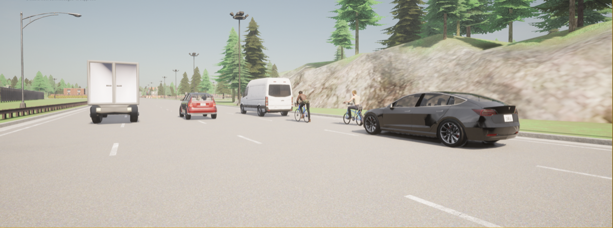
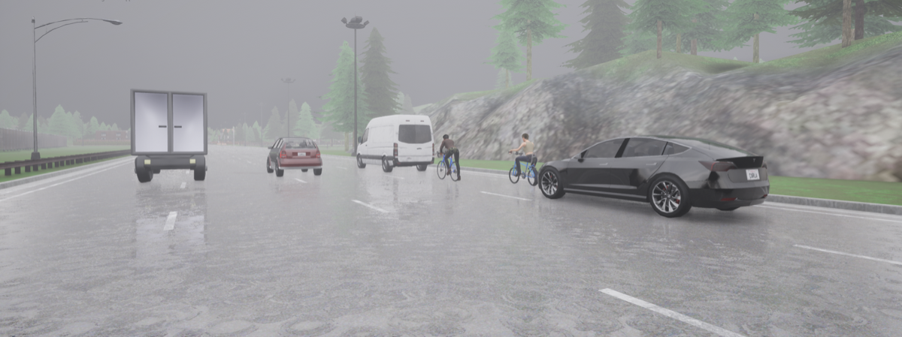
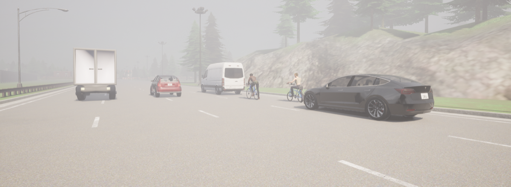
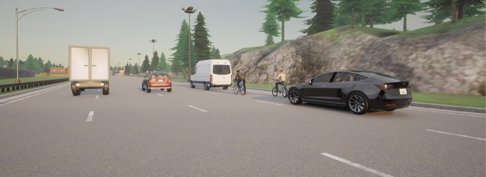
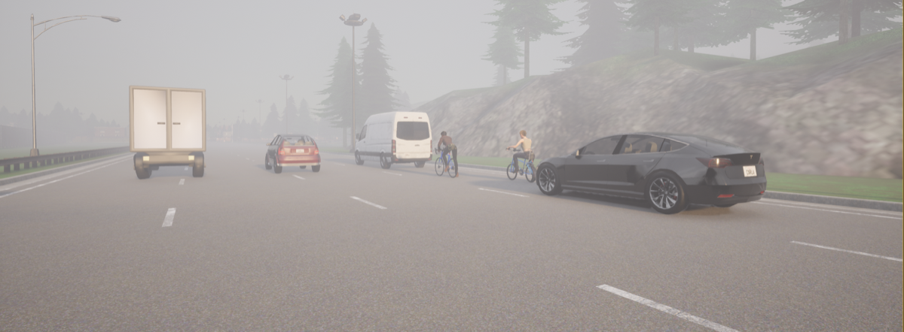
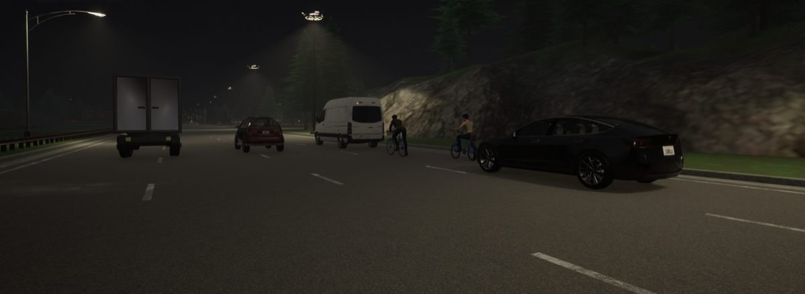
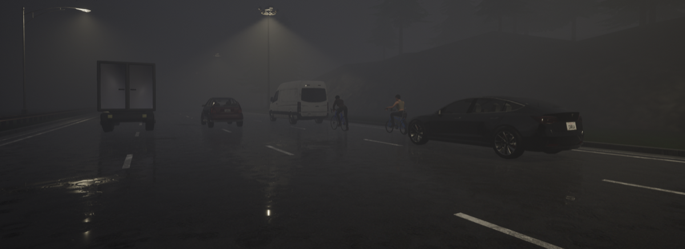
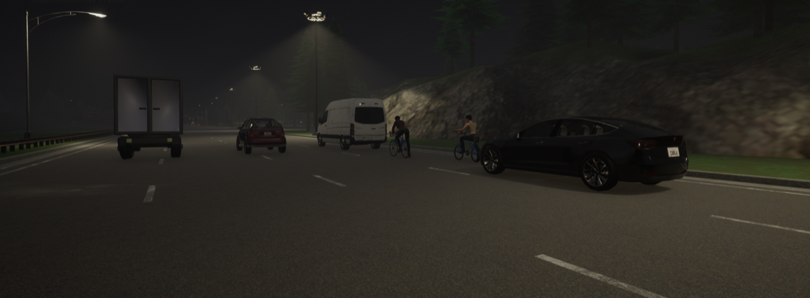

# 14. Kanagawa, Japan — Expressway Pedestrian Strike

**ID:** `14_REP_KAN` | **Date:** April 29, 2018 | **Location:** Kanagawa, Japan

## Incident Summary

| Field | Detail |
|-------|--------|
| Vehicle | Tesla Model X |
| AV System | Autopilot |
| Speed at Impact | ~24 mph (~39 km/h) |
| Original Weather | Clear |
| Original Lighting | Daylight |
| Outcome | Fatal collision |
| CARLA Map | Town06 |

A Tesla Model X on Autopilot accelerated following a lane change and struck a van, then continued into pedestrians on an expressway. The driver had fallen asleep at the wheel. This was the first documented case of an Autopilot-engaged vehicle striking and killing a pedestrian.

**Notes:** First reported Autopilot pedestrian fatality; driver had fallen asleep.

**Source:** [Forbes — Lawsuit against Tesla for Autopilot-engaged pedestrian death](https://www.forbes.com/sites/lanceeliot/2020/05/16/lawsuit-against-tesla-for-autopilot-engaged-pedestrian-death-could-disrupt-full-self-driving-progress/)

---

## CARLA Simulation

| Parameter | Value |
|-----------|-------|
| Map | Town06 |
| Origin | `x=-269.18, y=-11.36, z=1.05, yaw=1.15, pitch=-4.47, roll=0.00` |
| Destination | `x=-215.14, y=-11.72, z=1.31, yaw=-0.00, pitch=-1.91, roll=0.00` |

### Environmental Variations

| Noon — Clear | Noon — Rain | Noon — Fog |
|:---:|:---:|:---:|
|  |  |  |

| Twilight — Clear | Twilight — Fog | Night — Clear | Night — Rain | Night — Fog |
|:---:|:---:|:---:|:---:|:---:|
|  |  |  |  |  |

---

[Back to Dataset Overview](../README.md)
