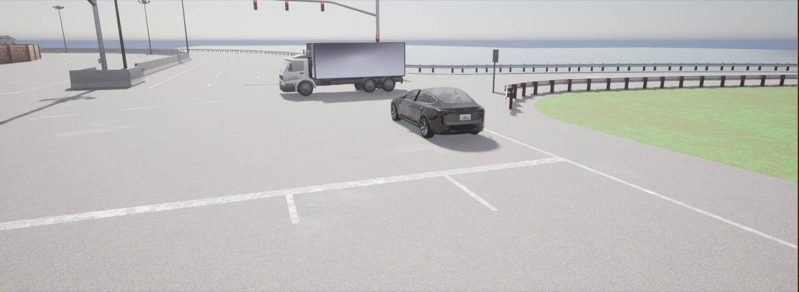
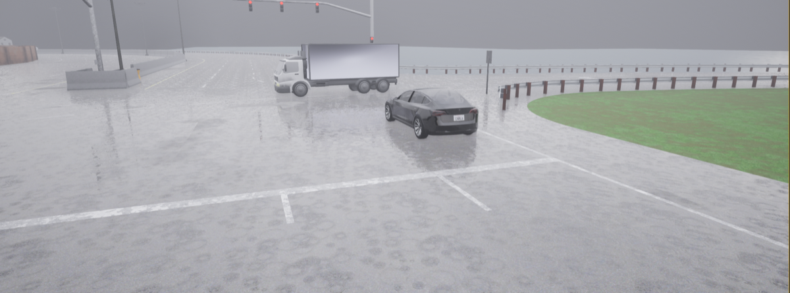
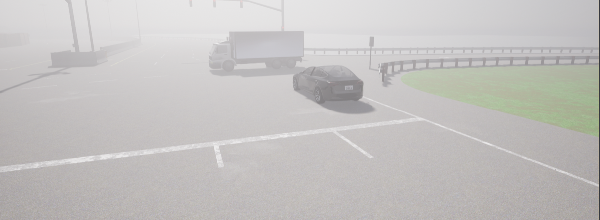
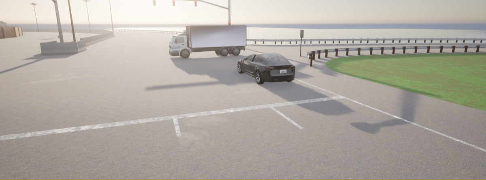
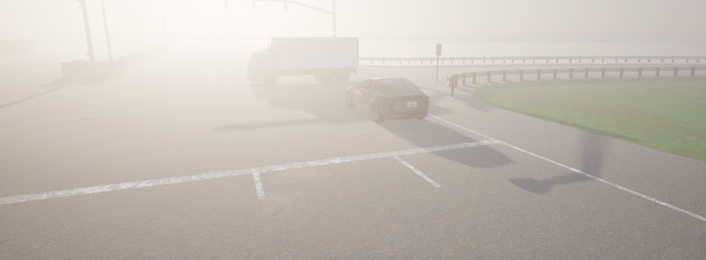
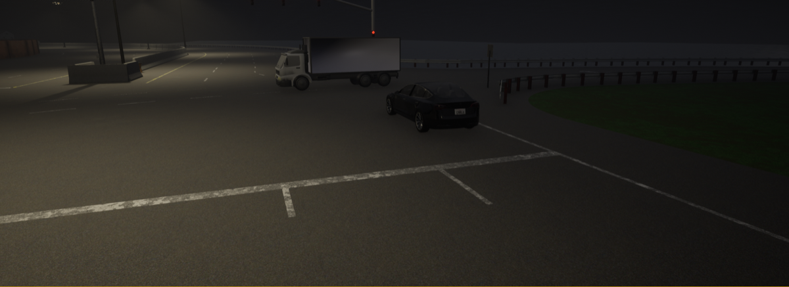
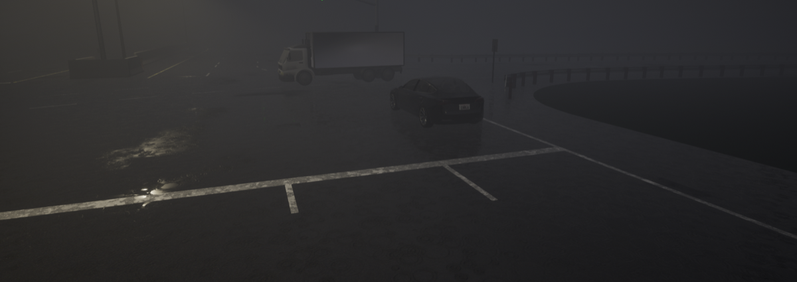
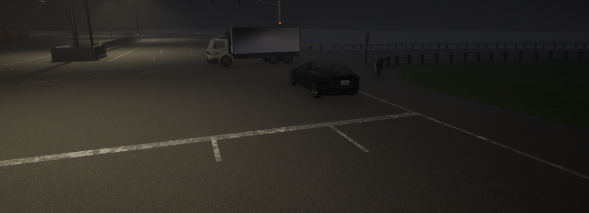

# 15. Delray Beach, Florida — Semi-Trailer Underride

**ID:** `15_REP_DELR` | **Date:** March 1, 2019 | **Location:** Delray Beach, Florida, USA

## Incident Summary

| Field | Detail |
|-------|--------|
| Vehicle | Tesla Model 3 |
| AV System | Autopilot |
| Speed at Impact | ~55 mph (~89 km/h) |
| Original Weather | Clear |
| Original Lighting | Dawn |
| Outcome | Fatal collision |
| CARLA Map | Town04 |

A Tesla Model 3 on Autopilot drove under a left-turning semi-trailer truck at a private driveway entrance at dawn, resulting in a fatality. Autopilot had been engaged for approximately 10 seconds before impact, and no hands were detected on the steering wheel for the final 8 seconds prior to the crash.

**Notes:** Autopilot engaged ~10 seconds before impact; no hands on wheel for 8 seconds prior.

**Sources:**
- [WPTV — Tesla driver killed after crash involving semi in western Delray Beach](https://www.wptv.com/news/region-s-palm-beach-county/serious-crash-investigated-on-u-s-441-in-southern-palm-beach-county)
- [NBC News — Man dies after Tesla crashes into semitrailer, Florida](https://www.nbcnews.com/news/us-news/man-dies-after-tesla-crashes-semitrailer-florida-n978466)
- [Palm Beach Post — Two federal agencies probing fatal Tesla crash near Delray](https://www.palmbeachpost.com/news/20190304/two-federal-agencies-probing-fatal-tesla-crash-near-delray)
- [Sun Sentinel — Tesla crash: Officials likely to probe if Autopilot played role](https://www.sun-sentinel.com/news/florida/fl-ne-ap-tesla-second-fed-agency-20190303-story.html)
- [The Verge — Tesla's Autopilot was engaged when Model 3 crashed into truck](https://www.theverge.com/2019/5/16/18627766/tesla-autopilot-fatal-crash-delray-florida-ntsb-model-3)
- [NTSB — Preliminary Report HWY19FH008](https://www.ntsb.gov/investigations/AccidentReports/Pages/HWY19FH008-preliminary-report.aspx)
- [NTSB — Accident Investigation Page HWY19FH008](https://www.ntsb.gov/investigations/Pages/HWY19FH008.aspx)
- [NTSB — Technical Reconstruction Factual Report (PDF)](https://data.ntsb.gov/Docket/Document/docBLOB?ID=8989779&FileExtension=pdf&FileName=Delray_Beach_FL-Technical%20Reconstruction%20Factual%20Report-Rel.pdf)
- [NTSB — Highway Accident Brief HAB-20/01 (PDF)](https://www.ntsb.gov/investigations/AccidentReports/Reports/HAB2001.pdf)
- [NTSB — Survival Factors Factual Report (PDF)](https://data.ntsb.gov/Docket/Document/docBLOB?ID=9018102&FileExtension=pdf&FileName=Survival%20Factors%20Factual%20report-Rel.pdf)
- [NTSB — Press Release: Final Reports for 2 ADAS Crash Investigations (March 2020)](https://www.ntsb.gov/news/press-releases/Pages/NR20200319.aspx)

---

## CARLA Simulation

| Parameter | Value |
|-----------|-------|
| Map | Town04 |
| Origin | `x=-306.70, y=4.47, z=1.37, yaw=178.93, pitch=-0.81, roll=0.00` |
| Destination | `x=-373.21, y=4.57, z=2.11, yaw=-179.03, pitch=-6.90, roll=0.00` |

### Environmental Variations

| Noon — Clear | Noon — Rain | Noon — Fog |
|:---:|:---:|:---:|
|  |  |  |

| Twilight — Clear | Twilight — Rain | Twilight — Fog |
|:---:|:---:|:---:|
|  |  |  |

| Night — Clear | Night — Rain | Night — Fog |
|:---:|:---:|:---:|
|  |  |  |

---

[Back to Dataset Overview](../README.md)
