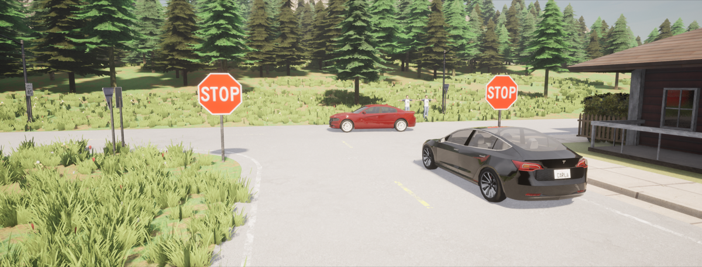
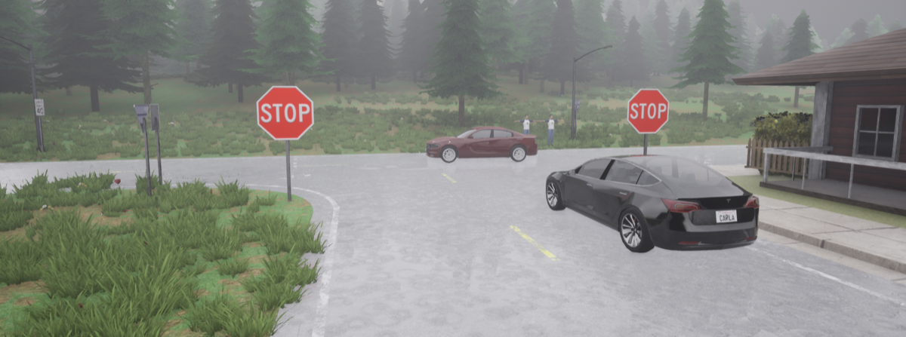
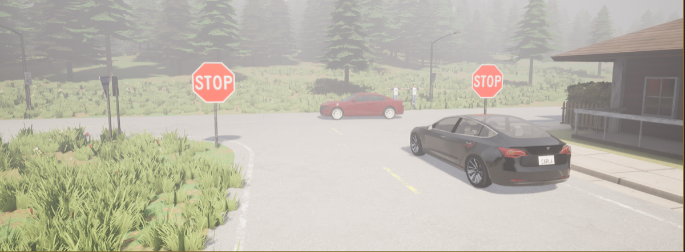
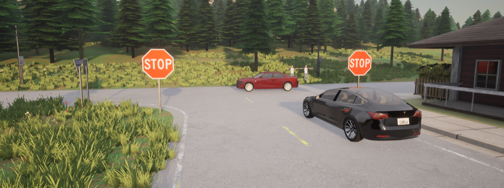
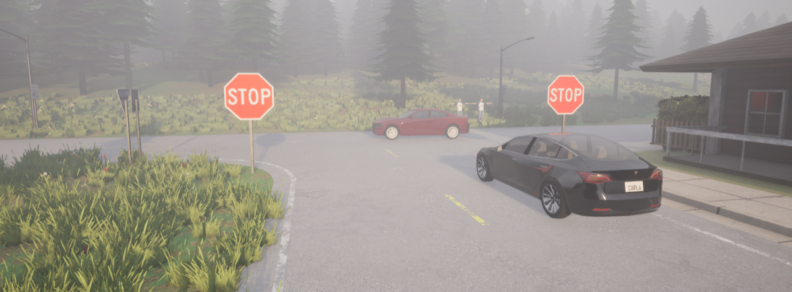
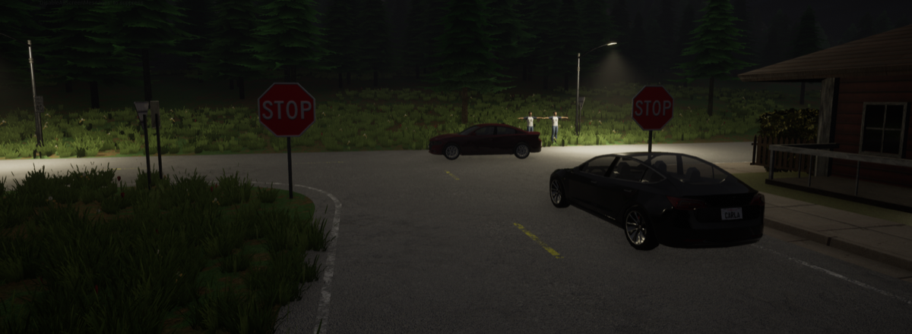
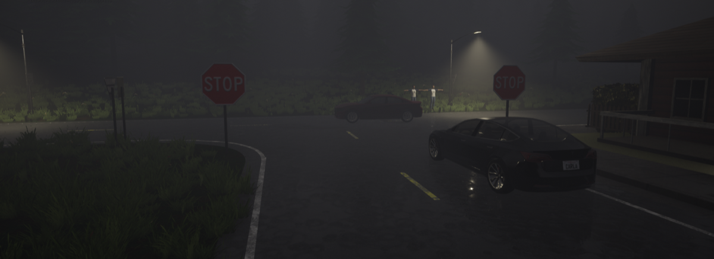
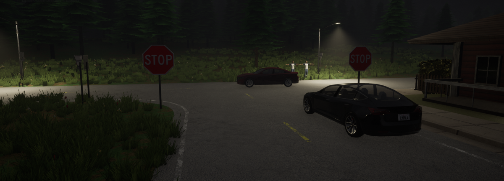

# 16. Key Largo, Florida — Stop Sign & Red Light Failure

**ID:** `16_REP_KEYL` | **Date:** April 25, 2019 | **Location:** Key Largo, Florida, USA

## Incident Summary

| Field | Detail |
|-------|--------|
| Vehicle | Tesla Model S |
| AV System | Autopilot |
| Speed at Impact | ~35 mph (~56 km/h) |
| Original Weather | Clear |
| Original Lighting | Daylight |
| Outcome | One fatality, two pedestrians injured |
| CARLA Map | Town07 |

A Tesla Model S on Autopilot ran through a stop sign and a flashing red light at a T-intersection, striking a parked SUV that was then pushed into two pedestrians, killing one. The driver had been distracted by a dropped phone. Autopilot was confirmed engaged at the time of the incident.

**Notes:** Driver distracted by dropped phone; confirmed Autopilot engaged at time of incident.

**Source:** [New York Times — Tesla Autopilot accident](https://www.nytimes.com/2021/08/17/business/tesla-autopilot-accident.html)

---

## CARLA Simulation

| Parameter | Value |
|-----------|-------|
| Map | Town07 |
| Origin | `x=-40.12, y=-156.59, z=3.07, yaw=-4.13, pitch=-12.17, roll=0.00` |
| Destination | `x=-5.30, y=-157.04, z=1.34, yaw=10.29, pitch=-3.01, roll=0.00` |

### Environmental Variations

| Noon — Clear | Noon — Rain | Noon — Fog |
|:---:|:---:|:---:|
|  |  |  |

| Twilight — Clear | Twilight — Rain | Twilight — Fog |
|:---:|:---:|:---:|
|  |  |  |

| Night — Clear | Night — Rain | Night — Fog |
|:---:|:---:|:---:|
|  |  |  |

---

[Back to Dataset Overview](../README.md)
