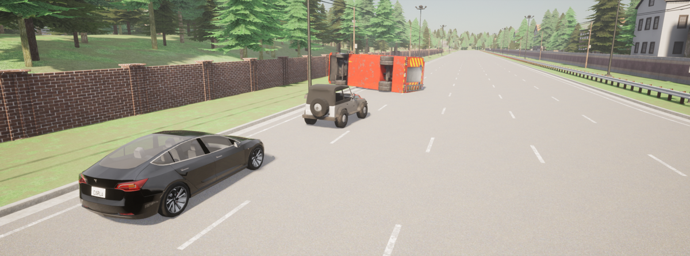
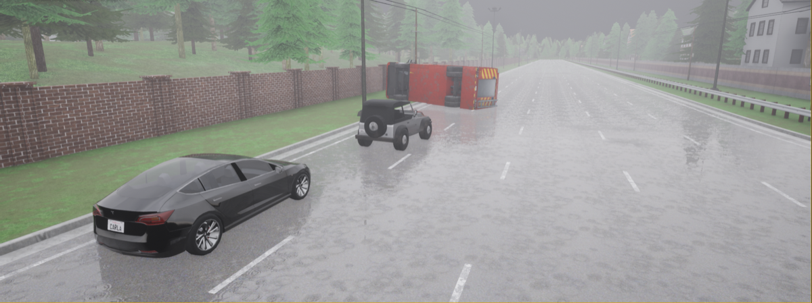
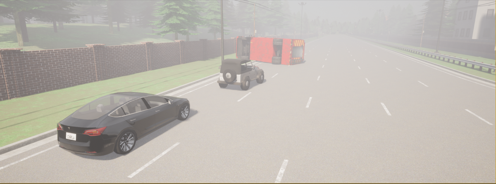
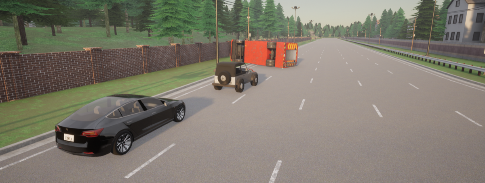
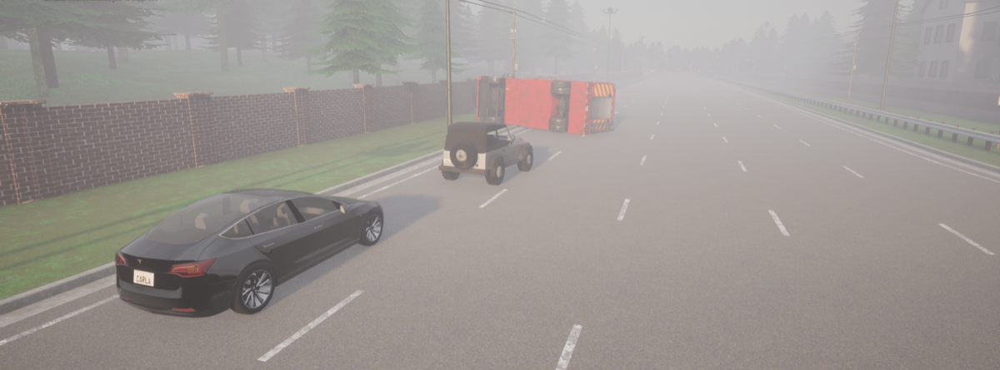
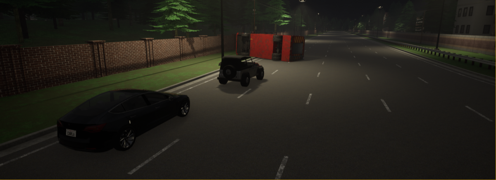
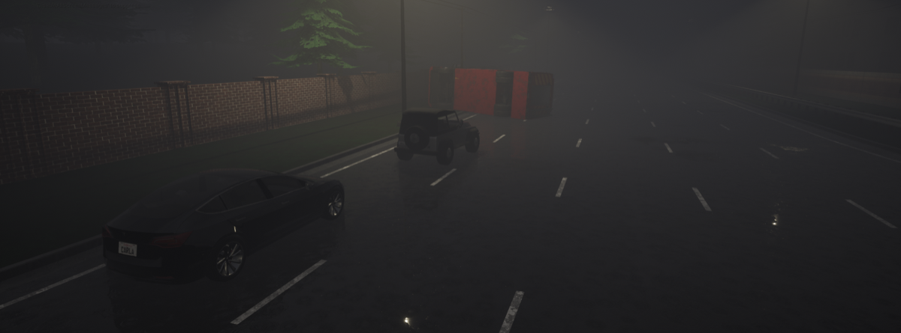
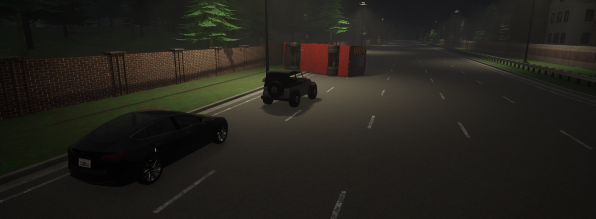

# 17. Cloverdale, Indiana — Parked Fire Truck

**ID:** `17_REP_CLVD` | **Date:** December 29, 2019 | **Location:** Cloverdale, Indiana, USA

## Incident Summary

| Field | Detail |
|-------|--------|
| Vehicle | Tesla Model 3 |
| AV System | Autopilot |
| Speed at Impact | ~70 mph (~113 km/h) |
| Original Weather | Clear |
| Original Lighting | Daylight |
| Outcome | One passenger fatality |
| CARLA Map | Town06 |


A Tesla Model 3 on Autopilot rear-ended a parked fire truck on an interstate highway at highway speed, killing one passenger. NHTSA confirmed Autopilot was engaged at the time of the crash. The surviving driver filed a civil lawsuit against Tesla in 2021.

**Notes:** NHTSA confirmed Autopilot use; driver filed civil lawsuit against Tesla in 2021.

**Sources:**
- [Indianapolis Star — One dead after vehicle hits firetruck parked on I-70](https://www.indystar.com/story/news/2019/12/29/one-dead-after-tesla-hits-parked-fire-truck-70/2771593001/)
- [Dubois County Herald — Tesla rear-ends fire truck killing woman](https://duboiscountyherald.com/b/telsa-rear-ends-fire-truck-killing-woman)
- [Banner Graphic — Fatal Tesla crash into fire truck was one year ago today](https://www.bannergraphic.com/story/2856765.html)
- [Indianapolis Star — Agency to investigate fatal I-70 Tesla, firetruck wreck](https://www.indystar.com/story/news/local/transportation/2020/01/09/fatal-indiana-tesla-crash-investigated-national-highway-traffic-safety-administration/4418773002/)
- [NHTSA — ODI Document PE 21-020 (PDF)](https://static.nhtsa.gov/odi/inv/2021/INOA-PE21020-1893.PDF)
- [PlainSite — Monet v. Tesla (Santa Clara County, civil lawsuit)](https://www.plainsite.org/dockets/4q175ldkg/superior-court-of-california-county-of-santa-clara/derrick-monet-v-tesla-inc/)
- [Justia — Monet v. Tesla (N.D. Cal, federal docket)](https://dockets.justia.com/docket/california/candce/5:2022cv00681/391325)

---

## CARLA Simulation

| Parameter | Value |
|-----------|-------|
| Map | Town06 |
| Origin | `x=200.65, y=137.27, z=0.95, yaw=-2.73, pitch=-2.98, roll=0.00` |
| Destination | `x=248.03, y=136.11, z=1.32, yaw=-2.65, pitch=-3.19, roll=0.00` |

### Environmental Variations

| Noon — Clear | Noon — Rain | Noon — Fog |
|:---:|:---:|:---:|
|  |  |  |

| Twilight — Clear | Twilight — Rain | Twilight — Fog |
|:---:|:---:|:---:|
|  |  |  |

| Night — Clear | Night — Rain | Night — Fog |
|:---:|:---:|:---:|
|  |  |  |

### Simulation Script

The CARLA reconstruction script for this scenario is [`scripts/17_REP_CLVD_scenario.py`](../scripts/17_REP_CLVD_scenario.py).

**Prerequisites:** CARLA 0.9.x running locally with PythonAPI configured.

**Run:**
```bash
# Place inside your CARLA PythonAPI directory tree, then:
python 17_REP_CLVD_scenario.py
```

Output frames and `metadata.jsonl` are saved to `./sessions/<timestamp>/`.

---

[Back to Dataset Overview](../README.md)
