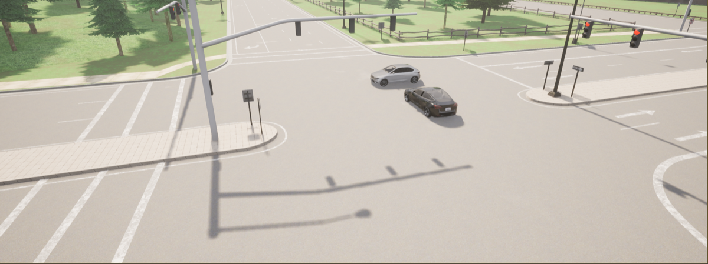
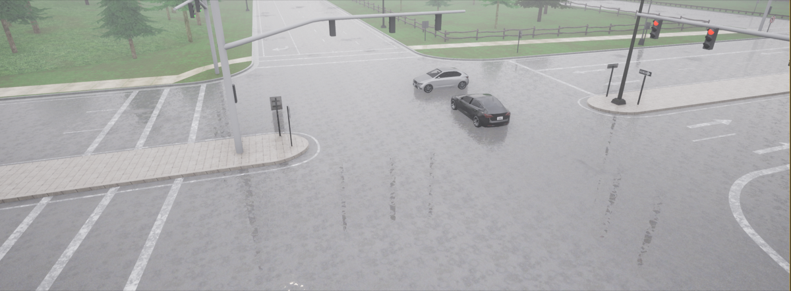
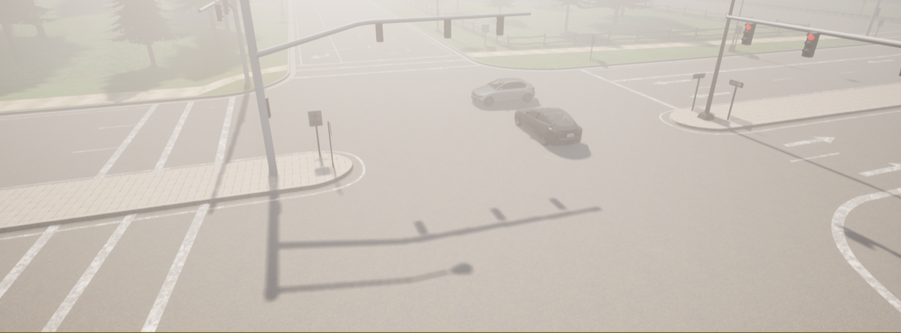
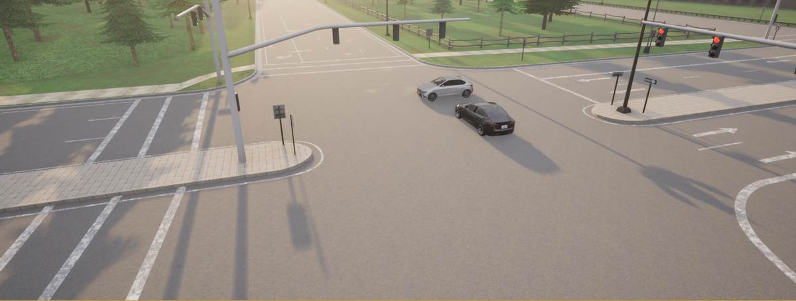
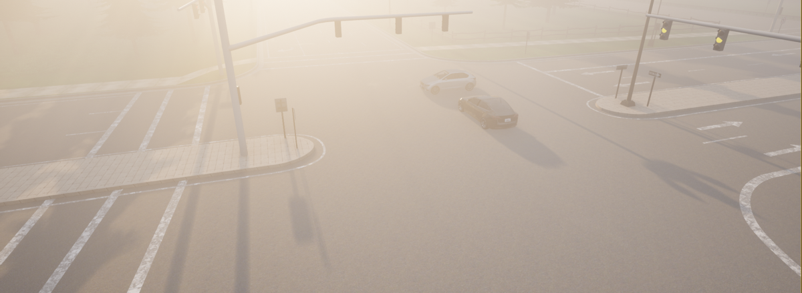
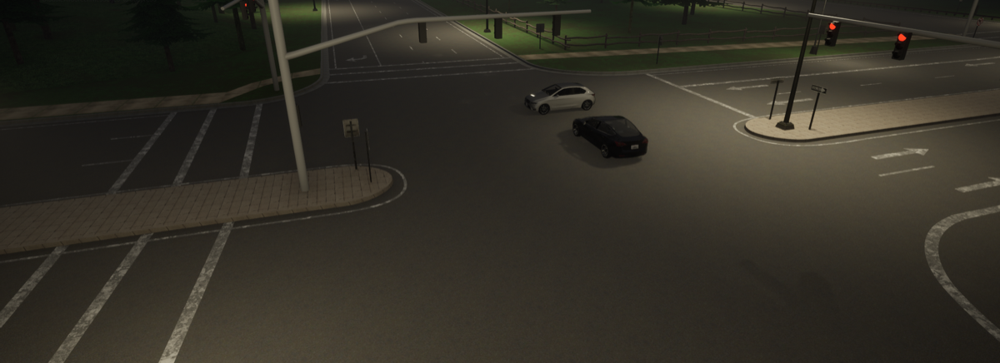
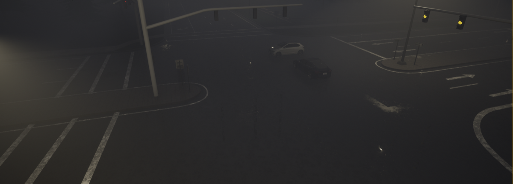
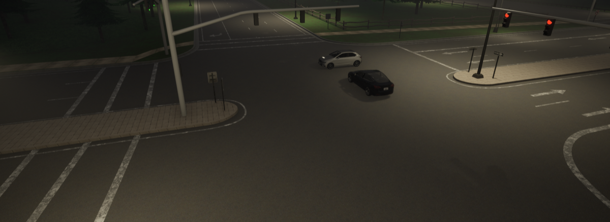

# 18. Gardena, California — Red Light Failure

**ID:** `18_REP_GARD` | **Date:** December 29, 2019 | **Location:** Gardena, California, USA

## Incident Summary

| Field | Detail |
|-------|--------|
| Vehicle | Tesla Model S |
| AV System | Autopilot |
| Speed at Impact | ~45 mph (~72 km/h) |
| Original Weather | Clear |
| Original Lighting | Night |
| Outcome | Two fatalities |
| CARLA Map | Town06 |

A Tesla Model S failed to stop for a red light after exiting a freeway at night, striking a turning Honda Civic and killing two occupants. NHTSA confirmed Autopilot was active at the time. The Tesla driver was subsequently charged with vehicular manslaughter — one of the first such criminal charges involving an Autopilot-related fatality.

**Notes:** NHTSA confirmed Autopilot engaged; Tesla driver charged with vehicular manslaughter.

**Sources:**
- [AP News — Feds will investigate deadly Tesla crash in California](https://apnews.com/article/technology-business-los-angeles-us-news-california-6eae3986e7d9c1d00db7d52146cddf23)
- [KTLA — Tesla driver suspected of running red light in Gardena crash](https://ktla.com/news/local-news/tesla-driver-suspected-of-running-red-light-in-gardena-crash-that-killed-2-lapd/)
- [Autoweek — NHTSA Will Probe Fatal Tesla Crash in LA](https://www.autoweek.com/news/technology/a30389608/nhtsa-will-probe-fatal-tesla-crash-in-la/)
- [Los Angeles Times — Fatal Tesla crash in Gardena being investigated by NHTSA](https://www.latimes.com/business/story/2019-12-31/fatal-tesla-crash-nhtsa-gardena-los-angeles)
- [AP News — Felony charges are 1st in a fatal crash involving Autopilot](https://apnews.com/article/tesla-autopilot-fatal-crash-charges-91b4a0341e07244f3f03051b5c2462ae)
- [Ars Technica — Manslaughter charges follow Tesla driver's Autopilot red light run](https://arstechnica.com/cars/2022/01/manslaughter-charges-follow-tesla-drivers-autopilot-red-light-run/)
- [Courthouse News — Judge orders trial in Tesla autopilot manslaughter case](https://www.courthousenews.com/judge-orders-trial-in-tesla-autopilot-manslaughter-case/)
- [AP News — Driver must stand trial for deadly Tesla crash in California](https://apnews.com/article/technology-california-los-angeles-a8412a63a4e392e95a47da1b4a539a68)
- [ABC7 — Tesla driver pleads not guilty in deadly crash](https://abc7.com/tesla-gardena-autopilot-crash/11920003/)
- [Reuters — Tesla driver's criminal trial in California delayed](https://www.reuters.com/legal/tesla-drivers-criminal-trial-california-delayed-2022-11-14/)
- [LA Daily News — Driver of Tesla on autopilot gets probation (June 2023)](https://www.dailynews.com/2023/06/30/driver-of-tesla-on-autopilot-gets-probation-for-crash-that-killed-2-in-gardena/)

---

## CARLA Simulation

| Parameter | Value |
|-----------|-------|
| Map | Town06 |
| Origin | `x=27.14, y=41.89, z=1.16, yaw=-177.63, pitch=-16.00, roll=0.00` |
| Destination | `x=27.14, y=41.89, z=1.16, yaw=-177.63, pitch=-16.00, roll=0.00` |

### Environmental Variations

| Noon — Clear | Noon — Rain | Noon — Fog |
|:---:|:---:|:---:|
|  |  |  |

| Twilight — Clear | Twilight — Rain | Twilight — Fog |
|:---:|:---:|:---:|
|  |  |  |

| Night — Clear | Night — Rain | Night — Fog |
|:---:|:---:|:---:|
|  |  |  |

---

[Back to Dataset Overview](../README.md)
