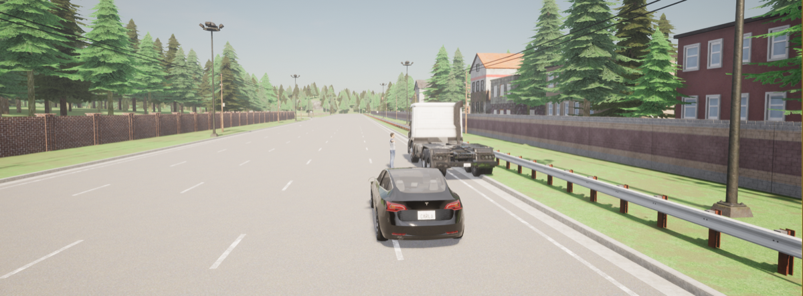
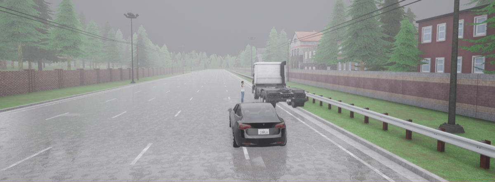
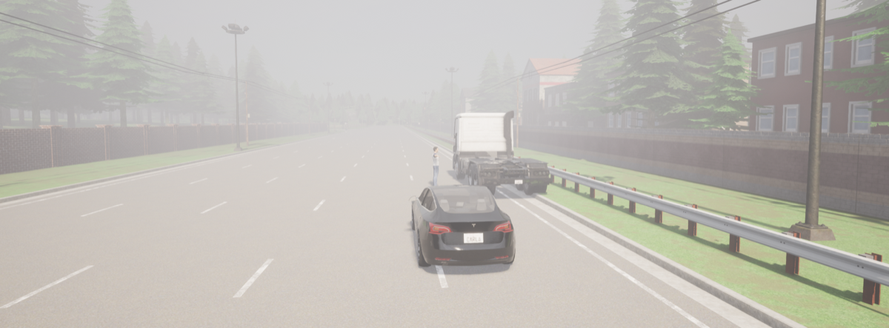
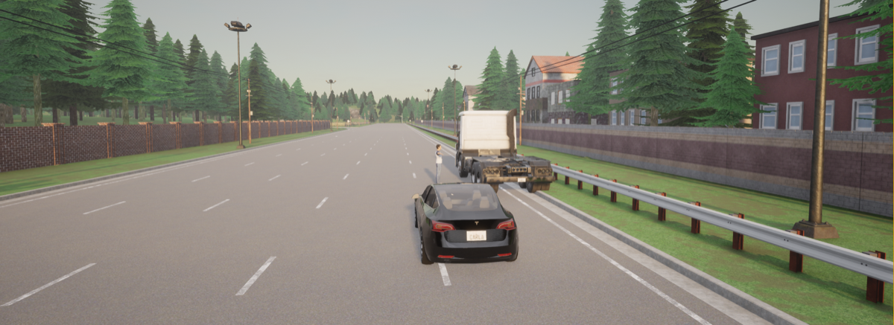
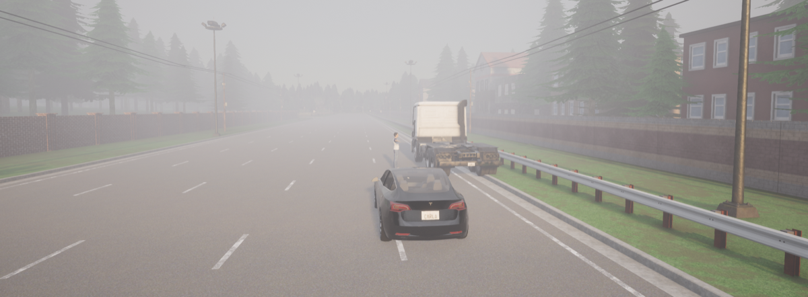
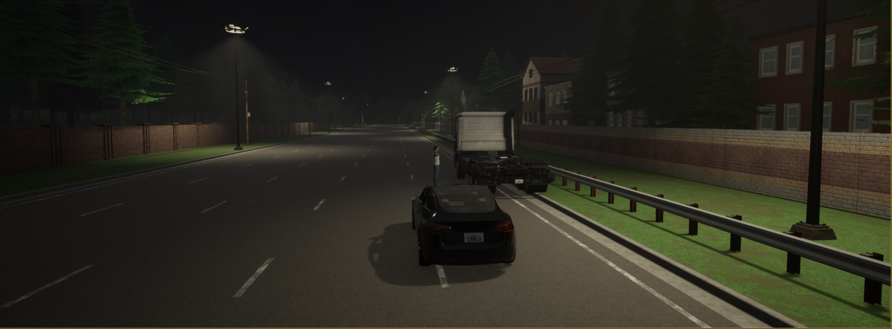
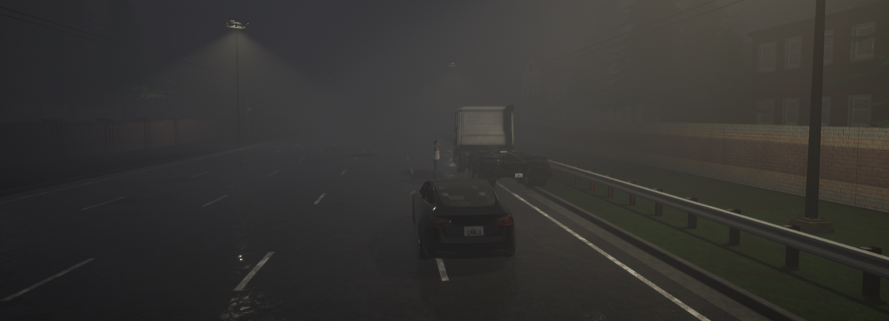
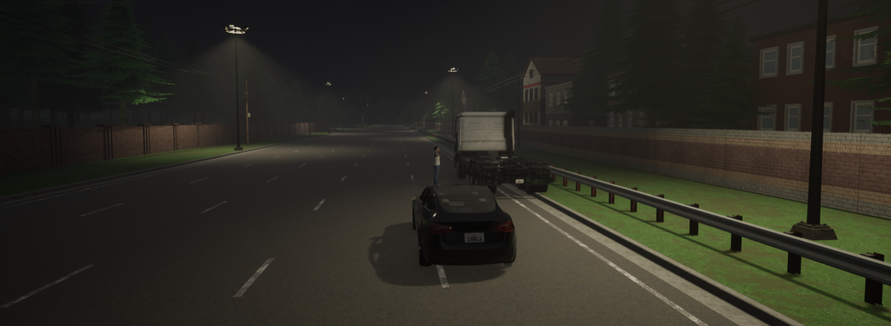

# 19. Arendal, Norway — Tunnel Exit Obstruction

**ID:** `19_REP_AREN` | **Date:** May 29, 2020 | **Location:** Arendal, Norway

## Incident Summary

| Field | Detail |
|-------|--------|
| Vehicle | Tesla Model S |
| AV System | Autopilot |
| Speed at Impact | ~68 mph (~109 km/h) |
| Original Weather | Clear |
| Original Lighting | Daylight |
| Outcome | Fatal collision |
| CARLA Map | Town06 |


A Tesla Model S on Autopilot struck a partially obstructing parked tractor-trailer on the highway hard shoulder immediately after exiting a tunnel, resulting in a fatal collision. Autopilot had been engaged approximately 4 km before the accident site. No warning lights or safety triangle were visible on the stationary truck.

**Notes:** Autopilot engaged ~4 km before accident site; no warning lights or triangle visible on truck.

**Sources:**
- [Accident Investigation Board Norway — Official Report 2022-06 (Norwegian)](https://havarikommisjonen.no/Vei/Avgitte-rapporter/2022-06)
- [motor.no — Tesla på auto-styring da mann ble meid ned (Norwegian)](https://motor.no/a/188623)
- [TU.no — Fatal accident near Arendal: Tesla's Autopilot made driver less engaged (Norwegian)](https://www.tu.no/artikler/dodsulykke-ved-arendal-teslas-autopilot-gjorde-at-foreren-var-mindre-engasjert-i-kjoreprosessen/521337)
- [Havarikommisjonen — Ongoing investigations page](https://havarikommisjonen.no/Vei/Pagaende-undersokelser)

---

## CARLA Simulation

| Parameter | Value |
|-----------|-------|
| Map | Town06 |
| Origin | `x=282.39, y=150.08, z=1.10, yaw=-2.59, pitch=-8.62, roll=0.00` |
| Destination | `x=338.88, y=150.49, z=1.94, yaw=-0.77, pitch=-7.79, roll=0.00` |

### Environmental Variations

| Noon — Clear | Noon — Rain | Noon — Fog |
|:---:|:---:|:---:|
|  |  |  |

| Twilight — Clear | Twilight — Rain | Twilight — Fog |
|:---:|:---:|:---:|
|  |  |  |

| Night — Clear | Night — Rain | Night — Fog |
|:---:|:---:|:---:|
|  |  |  |

### Simulation Script

The CARLA reconstruction script for this scenario is [`scripts/19_REP_AREN_scenario.py`](../scripts/19_REP_AREN_scenario.py).

**Prerequisites:** CARLA 0.9.x running locally with PythonAPI configured.

**Run:**
```bash
# Place inside your CARLA PythonAPI directory tree, then:
python 19_REP_AREN_scenario.py
```

Output frames and `metadata.jsonl` are saved to `./sessions/<timestamp>/`.

---

[Back to Dataset Overview](../README.md)
