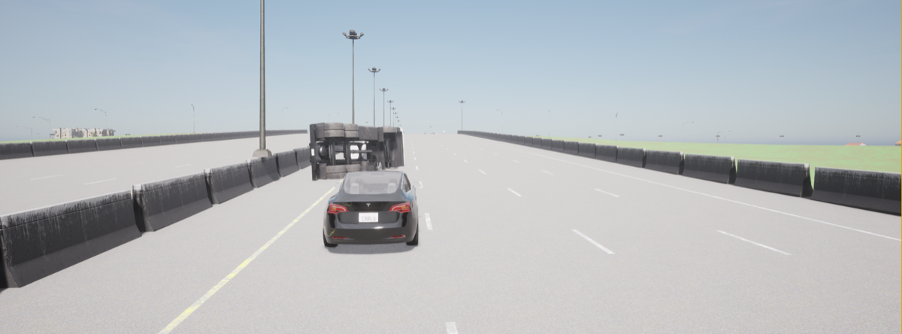
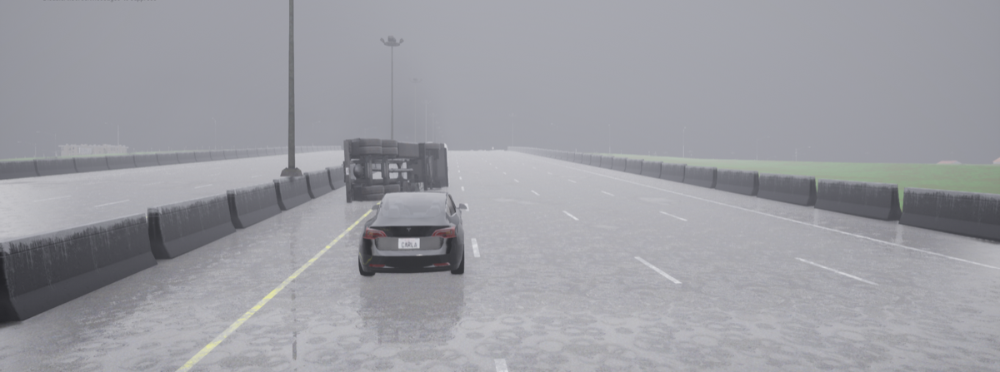
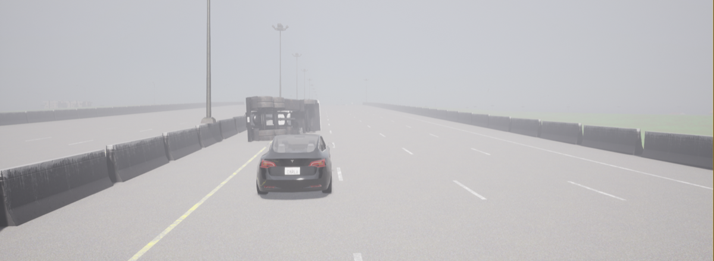
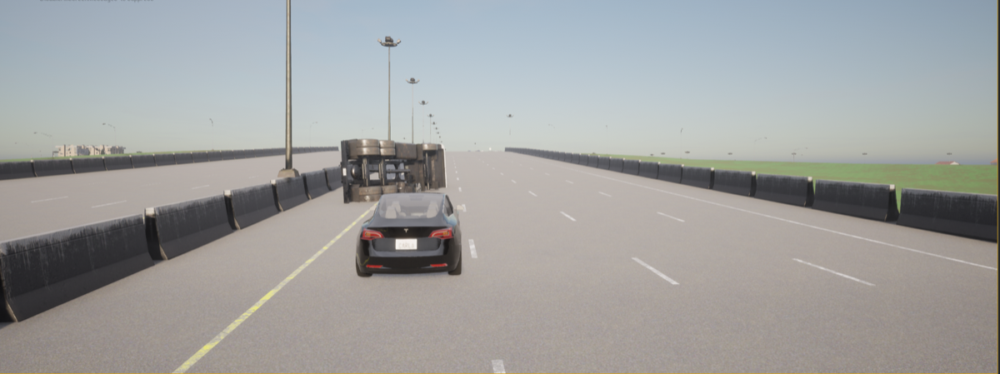
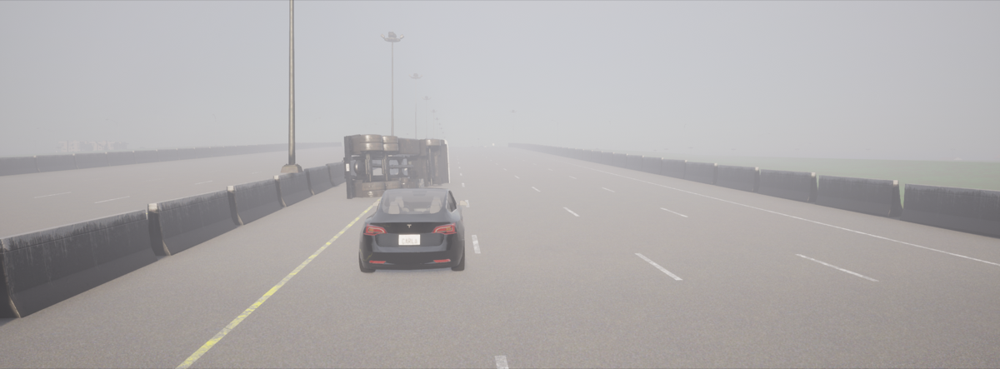
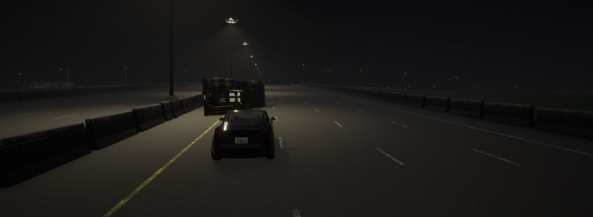
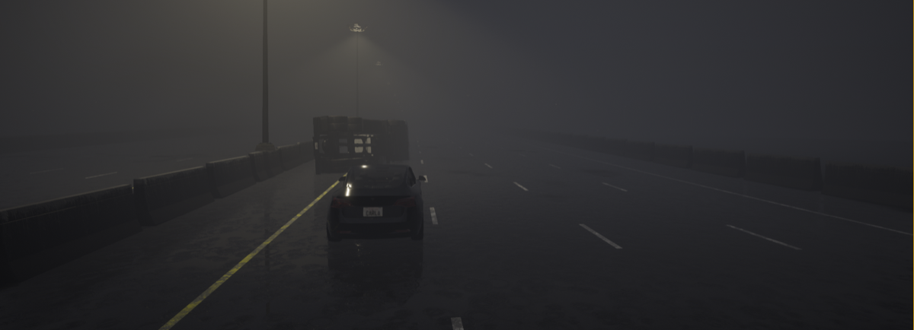
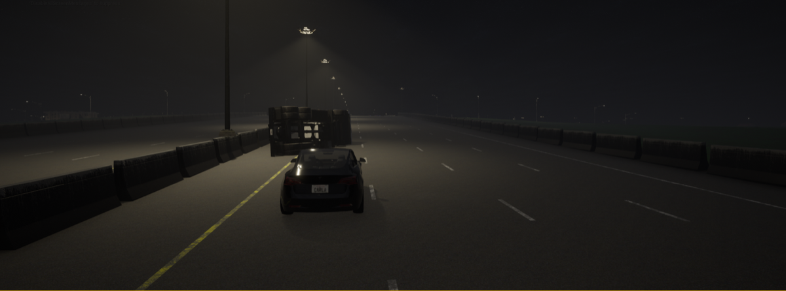

# 20. Fontana, California — Overturned Freeway Trailer

**ID:** `20_REP_FONT` | **Date:** May 5, 2021 | **Location:** Fontana, California, USA

## Incident Summary

| Field | Detail |
|-------|--------|
| Vehicle | Tesla Model 3 |
| AV System | Autopilot |
| Speed at Impact | ~65 mph (~105 km/h) |
| Original Weather | Clear |
| Original Lighting | Night |
| Outcome | Driver fatality, bystander injured |
| CARLA Map | Town04 |

> *Accident diagram not available for this scenario.*

A Tesla Model 3 with automated driving engaged struck an overturned tractor-trailer blocking the freeway at night, fatally injuring the driver and injuring a bystander who had stopped to assist. The California Highway Patrol confirmed Autopilot was active at the time, and NHTSA initiated a formal investigation.

**Notes:** CHP confirmed Autopilot engaged; NHTSA investigation initiated.

**Source:** [CBS News LA — Tesla driver killed in big rig wreck on 210 Freeway in Fontana](https://www.cbsnews.com/losangeles/news/tesla-driver-killed-big-rig-wreck-on-210-freeway-in-fontana-good-samaritan-hurt/)

---

## CARLA Simulation

| Parameter | Value |
|-----------|-------|
| Map | Town04 |
| Origin | `x=-299.03, y=26.38, z=1.78, yaw=0.56, pitch=-1.15, roll=0.00` |
| Destination | `x=-219.47, y=26.94, z=5.34, yaw=-1.93, pitch=-7.84, roll=0.00` |

### Environmental Variations

| Noon — Clear | Noon — Rain | Noon — Fog |
|:---:|:---:|:---:|
|  |  |  |

| Twilight — Clear | Twilight — Fog | Night — Clear | Night — Rain | Night — Fog |
|:---:|:---:|:---:|:---:|:---:|
|  |  |  |  |  |

---

[Back to Dataset Overview](../README.md)
